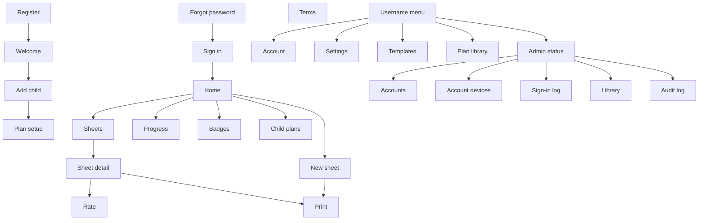

# Math Facts Worksheet Generator — Product Spec

**Version:** 1.23 (draft)
**Owner:** Kevin
**Target platform:** Raspberry Pi (web app on the home network first; external hosting with HTTPS is Phase 2)
**Primary language:** Python

---

## 1. Purpose

A self-hosted website where parents register an account, add their children, and generate printable math-fact worksheets (addition, subtraction, multiplication, division) so each child can build fluency through repetition. The parent chooses exactly which facts appear and how the sheet is laid out, then records a quick overall rating for how the sheet went. The app keeps a history of every sheet, shows each child's progress with graphs, follows learning plans that move from easy fact sets to harder ones, and awards badges that appear on the child's next printed sheet.

Each family's data is private to its own account. The first release runs **internally on the home network**; hosting it externally comes later (Phase 2).

### Goals
- **Let multiple families use the site:** open registration with a username/email and password, then add children and set up plans for each child.
- **Stay signed in:** after registering or signing in, the browser is remembered so returning users are signed in automatically until they sign out.
- **Know who signed in and from where:** log hard sign-ins (with a password) and soft sign-ins (automatic, via the remembered-device cookie), tracked by device.
- **Simple administration:** the first person to register is the Administrator, who can inactivate users and reset their passwords to a default.
- Create targeted fact sheets in seconds (e.g., "1–9 × 2" or "0–12 × 1–2").
- Print cleanly on a single US Letter page, automatically sized to fit.
- Keep a history of every sheet, with exact reprints.
- Regenerate a sheet you don't like; delete sheets that were never finished.
- Record a quick, simple rating after each sheet (performance, pace, level of support).
- Provide a **Progress section** with graphs, a plan journey view, and milestones.
- Provide **learning plans** per operation with a "next sheet" button, using an advancement method that does **not** require working without aids.
- Provide **badges** that motivate the child and print on her next sheet.

### Non-Goals
- No per-problem grading or answer entry. Ratings are overall, per sheet.
- No stopwatch or minute-level time tracking.
- **No child logins.** Children never have accounts; only parents/guardians do.
- No child-facing on-screen quizzing (print-first).
- **No email in the first release** (no verification, no password-reset emails; see 5.11.8).
- **No internet hosting or HTTPS in the first release** (Phase 2).
- No payments, social login, or public sharing of progress.
- No word problems, fractions, decimals, or multi-digit arithmetic beyond fact ranges.
- No native mobile app. The same website is used on a phone, a tablet, and a computer (7.2).

### Design Principles
1. **Support is information, not a penalty.** The child has a learning disability, so using a times table or other aid is expected and fully counts toward advancement. Working with less support is tracked and celebrated as growth, never required as a gate.
2. **The parent is always in control.** The app suggests when to advance; the parent decides. Stages can be repeated, skipped, or revisited at any time.
3. **Forgiving progress rules.** One rough day should not undo progress. Rules look at recent sheets as a whole, not a single failure.
4. **Positive child-facing output.** Printed sheets show only the child's name, the problems, and badges. Ratings, scores, and labels like "Needs improvement" are parent-only and never print.
5. **No time pressure.** Pace is an optional observation, never a requirement.
6. **Private by default.** Every family's children, sheets, ratings, and plans are visible only to that family's account. Collect the minimum data about children (a first name or nickname).
7. **Convenient but accountable sign-in.** Parents stay signed in on their own devices, and every sign-in is logged so devices can be reviewed and revoked.

---

## 2. Users and Roles

| Role | Description |
|---|---|
| **Administrator** | The **first account registered**. Can see the list of accounts, **inactivate/reactivate** accounts, **reset a user's password to the default**, and review the sign-in and device log (see 5.13). **Cannot view other families' children, sheets, ratings, or notes through the UI.** Also a normal parent account with its own children. |
| **Parent / Guardian (account holder)** | Registers an account, adds children, builds sheets, prints, rates completed sheets, reviews progress, and edits plans. Sees only their own children's data. Awarding a custom badge by hand is Phase 3. |
| **Child** | Has no account. Receives printed sheets. Appears in the app only as a name and a data record owned by a parent account. |

An account can have multiple children. (Sharing a child with a second adult, such as a co-parent, is a Phase 3 item.)

---

## 3. Recommended Technical Approach

These are recommendations; the implementer may substitute equivalents.

- **Backend:** Python 3.11+, **Flask** (lightweight for a Pi), Jinja2 templates.
- **Database:** **SQLite** in WAL mode (single file, easy backup, handles several concurrent users). Use SQLAlchemy or plain `sqlite3`. Run a small number of gunicorn workers (2–3).
- **Auth libraries (suggested):** Flask-Login or a small custom session layer (needed for the custom remembered-device cookie in 5.11.3), **argon2-cffi** (password hashing; or scrypt via `werkzeug.security` if argon2 is hard to install on the Pi), Flask-WTF (CSRF), a rate limiter (e.g., Flask-Limiter with a DB or in-memory store), `secrets` for tokens, a small user-agent parser (e.g., `user-agents`) to summarize browser/OS.
- **Frontend:** Server-rendered HTML + a small amount of vanilla JS (or HTMX). **No Node build step.** One stylesheet uses CSS custom properties for the light and dark themes (section 7, Look and theme). Fonts are a bundled file or the device's own fonts. No request to a font service.
- **Printing:** Browser print with a dedicated print stylesheet (`@media print`, `@page { size: Letter; margin: 0.5in; }`). Optional PDF download in a later phase.
- **Charts:** Lightweight client-side chart library (e.g., Chart.js) bundled locally so it works offline.
- **Badge art:** Simple inline **SVG** icons stored with the app (original artwork; no third-party characters or trademarked imagery). Icons must read clearly in **black-and-white** printing.
- **One process.** Pages and the small JSON routes (`/api/...`) are the same Flask app, the same session, and the same account checks. There is no separate API service and no second port for the API.
- **Deployment (Phase 1, internal):** The Pi at `192.168.1.26` already runs nginx and PHP, and port 80 is in use. This app stays Python. PHP is not involved.
  - Ports in use on that Pi (checked over SSH): 22, 80 (default nginx), 111, 2049, 3306 (MariaDB, local), 8000, 8001–8003 (local), 8080 (`networktraffic` PHP site), 8090, 8888 (`security-cameras`), 9100. Ports 8016 and 8017 are free.
  - `gunicorn` runs as a **systemd** service and listens only on `127.0.0.1:8017`. It is not reachable from other devices.
  - A new nginx site, `mathfacts`, listens on **8016** and proxies to `127.0.0.1:8017`. The site is `http://192.168.1.26:8016`. Do not change the existing `networktraffic` or `security-cameras` sites, do not take port 80, and do not add this app as a path on the existing PHP site.
  - Plain HTTP on the home network. `COOKIE_SECURE` stays off until HTTPS. No port forwarding to the internet.
- **Deployment (Phase 2, external):** HTTPS on the same nginx site (or a tunnel), `Secure` cookies on, additional hardening (see 10). No new app server.
- **Config:** Single `config.py` or `.env` for the local bind (`127.0.0.1:8017`), the public base URL (`http://192.168.1.26:8016`), DB path, secret key, and default paper size.
- **Backups:** A script/CLI command that copies the SQLite file to a timestamped backup, plus per-account data export (5.10).
- **Capacity target:** dozens of accounts and a few hundred sheets per child on a Raspberry Pi 4 or newer; not designed for thousands of concurrent users.

---

## 4. Core Concepts

### 4.1 Account
A parent/guardian login (email, username, password) that owns children, sheets, plans, templates, and settings.

### 4.2 Child
A child record (first name or nickname, optional grade, optional color) owned by exactly one account. All sheets, ratings, plan progress, and badges belong to a child.

### 4.3 Device
A specific browser on a specific computer, phone, or tablet, identified by a long-lived **device ID cookie**. Used to track and manage where an account is signed in.

### 4.4 Hard login and soft login
- **Hard login:** the user proves who they are by entering credentials (username/email + password), or by completing registration.
- **Soft login:** the user returns to a device that was previously signed in and is signed in automatically through the remembered-device cookie, with no password.

### 4.5 Fact
A single problem defined by two operands and an operation, e.g. `7 × 6`. Every fact has a canonical key: `op:a:b` (e.g., `mul:7:6`).

- Order matters in subtraction and division. For addition and multiplication, `3 × 7` and `7 × 3` are **separate problems** on a sheet. A builder toggle, "include reverse order" (5.1), adds the swapped pair to the pool. A different account setting, "treat commutative pairs as the same fact" (default **off**), affects only the coverage map (5.5): when it is on, `3 × 7` and `7 × 3` share one cell. It does not change what is printed.

### 4.6 Fact Set
The pool of facts a sheet draws from, defined by two operand specifications (see 5.1).

### 4.7 Worksheet
An issued sheet: a saved configuration plus the exact ordered list of problems generated. Reprinting reproduces the same problems. A worksheet has a status:
- **Issued:** printed or saved, not yet rated (the default).
- **Completed:** rated by the parent.

### 4.8 Rating
A quick, overall assessment of a completed sheet (see 5.4): performance, pace, and support level.

### 4.9 Learning Plan
An ordered list of **stages** for one operation. Each stage defines a fact set and an advancement rule. The app ships with **system plan templates** (read-only). When a parent sets up a plan for a child, the app creates an **account-owned copy** that the parent can edit freely. A child has a **current stage** per plan.

### 4.10 Badge
A recognition earned by a child for effort, consistency, achievement, or growth (see 5.7). Newly earned badges print on the child's next sheet.

---

## 5. Functional Requirements

> Note: every page and API below, except those in 5.11.1 marked "public," **requires a signed-in account** and is scoped to that account's data.

### 5.1 Worksheet Builder

**Inputs**

| Field | Details |
|---|---|
| Child | Dropdown of the account's children. |
| Operation | Addition, Subtraction, Multiplication, Division. |
| Operand A set | Flexible number spec (see below). |
| Operand B set | Flexible number spec (see below). |
| Orientation | How each problem is drawn: Vertical (stacked) or Horizontal (inline). |
| Page direction | Portrait (default) or Landscape. Independent of problem orientation. The builder may suggest landscape; it never changes direction on its own. |
| Problems across | Integer 1–10 (columns). |
| Problems down | Integer 1–20 (rows). |
| Problem order | Sequential / Shuffled / Random with repeats. |
| Title | Optional; default auto-generated (e.g., "Multiplication: 1–9 × 2"). |
| Header options | Name line, Date line (each toggle). |
| Badges on sheet | Toggle (default on; see 5.7.4). |
| Answer key | Toggle. When on, the same print job includes a second page with answers (see 5.2). |
| Allow negatives | Subtraction only. Default **off**. When off, facts with A < B are dropped. |
| Sizing | **Auto-fit (always on; see 5.2.1).** Optional "Spacing" nudge: Roomy / Normal / Compact. There is no fixed font-size choice. |
| Paper | US Letter in the first release. A4 is Phase 3. |

**Number spec syntax** (used for Operand A and Operand B)
A text field with live validation and a preview that expands it. Accepts:
- Single number: `2`
- Range: `1-9`
- List: `2,4,6`
- Mixed: `0-3, 5, 10`
- Values 0–20 for addition/subtraction operands and 0–12 for multiplication/division by default; configurable max (up to 100) in account settings.

**Examples**
- "1 through 9 times 2" → A = `1-9`, B = `2`, op = multiplication → 9 unique facts.
- "1 through 9 times 1 through 2" → A = `1-9`, B = `1-2` → 18 unique facts.
- "Facts 0 through 3" → A = `0-3`, B = `0-3` → 16 facts.

**Operation-specific semantics**

| Operation | Operand A | Operand B | Rule |
|---|---|---|---|
| Addition | first addend | second addend | `A + B` |
| Subtraction | minuend (top number) | subtrahend | `A − B`; **drop combinations where A < B** (no negatives) unless "allow negatives" is on (default off). |
| Multiplication | multiplicand | multiplier | `A × B` |
| Division | **divisor** | **quotient** | Problem is `(A × B) ÷ A = B`. Never divide by zero: if A includes 0, drop those facts (show a warning). This keeps division as the inverse of the multiplication fact family. |

For division, the UI labels the fields **"Divisor"** and **"Quotient"**, and the preview shows e.g. `12 ÷ 3`.

**Include reverse order toggle** (for addition/multiplication): when on, both `A op B` and `B op A` are included in the pool.

**Pool vs. slots behavior**
Let `slots = across × down` and `pool` = number of unique facts.
- `pool == slots`: each fact appears once.
- `pool > slots`: pick `slots` facts uniformly at random. Favoring facts from recent low-rated sheets ("focus on recent trouble") is Phase 3 (5.5).
- `pool < slots`: repeat facts as evenly as possible so the page is still full. Each fact appears ⌊slots/pool⌋ times, and the remaining spaces are filled by a random extra copy of some of those facts. This is extra practice, not a shortage to avoid. Example: 10 across × 10 down is 100 spaces, and `0-10 × 2` is 11 facts, so each fact appears 9 times and one fact appears 10 times. The builder shows a notice such as "11 facts will repeat about 9× each."
- **The same problem does not sit next to itself.** Two cells that share a side (left, right, above, or below) must be different facts. Touching at a corner is allowed. This holds for Sequential, Shuffled, and Random with repeats. Sequential order walks the facts in A-then-B order and then starts again, so copies are spread through the page instead of grouped. The only case that cannot be separated is a page of a single fact; the notice then says every problem is the same.

**Live preview**
An on-screen preview of the page exactly as it will print (including any badge banner), updating as inputs change. Also displays unique facts count, slots, repeats, and the auto-fit size (see 5.2.1).

**Buttons:** *Generate & Print*, *Save without printing*, *Regenerate*, *Save as Template*.

**Regenerate (before saving)**
*Regenerate* in the builder re-rolls the arrangement (and, when `pool > slots`, the choice of facts) using a new random seed, with the same settings. The preview updates immediately. The user can regenerate as many times as they like; nothing is stored until they save or print.

### 5.2 Printing Layout

**Vertical format**
```
    7
  × 6
 -----

```
- Right-aligned operands, operator on the second line to the left of the lower number, horizontal rule under the operator and the lower number, blank space for the answer.
- Division in vertical mode uses the long-division bracket layout: `divisor ⟌ dividend`. The bracket is one connected mark (top bar and left stroke together), not a parenthesis plus a separate line.

**Horizontal format**
```
7 × 6 = ______
```
- Left-aligned, answer blank at end. Division uses `÷`; multiplication uses `×`.

**Common**
- Header: title, optional Name / Date lines, and the **badge banner** when the child has new badges (5.7.4).
- Footer (small, grey): sheet number (e.g., `#0042`) and plan stage, so a lost sheet can be looked up.
- **Ratings and scores never print.** There is no score line.
- Print CSS hides all UI chrome (nav, buttons).
- The problem grid **always fits on exactly one page** (see 5.2.1). It must never split or spill onto a second page.
- **Answer key.** The builder toggle adds the answer key as page 2 of the same print job. From history, **Reprint** prints the worksheet only, and **Reprint with answer key** adds page 2 whether or not the toggle was on when the sheet was saved. The answer key uses the same grid and font size, with answers filled in, and never shows the badge banner.
- Must render correctly when printed from Chrome, Edge, Safari, and Firefox to Letter.

#### 5.2.1 Auto-Fit Layout

Whatever the user chooses for across × down, orientation, and header options, the sheet scales itself to fit one page. Size is computed, not chosen.

**Algorithm (runs server-side for the print page and the live preview, so both match exactly)**
1. **Printable area** = paper size minus margins (Letter: 7.5in × 10in at 0.5in margins; landscape swaps the dimensions).
2. **Reserve header and footer height** based on which header options are on, **including a fixed-height badge banner row (~0.7in) when the sheet has badges to show**. The remaining height is the grid area.
3. **Cell size:** `cell_w = grid_w / cols`, `cell_h = grid_h / rows`.
4. **Font size** is the largest value (in pt) such that the full problem fits inside its cell with required padding:
   - *Vertical:* needs about 3 text lines (top number, operator + bottom number, rule) plus an **answer writing space of at least 1 line height**. The widest problem on the sheet (e.g., `12 × 12`, `144 ÷ 12`) determines the width requirement. For division, add room for the bracket.
   - *Horizontal:* needs the widest expression (`144 ÷ 12 = ____`) on one line, with the blank at least ~4 characters wide.
   - Font size = `min(height-limited size, width-limited size)`, then scaled by the Spacing nudge. Spacing is about blank space in the cell, not a request for a larger font: **Roomy ≈ 85%** of the fitted size (more blank space), **Normal = 100%**, **Compact ≈ 110%** (larger type, less blank space). Compact is never allowed to overflow the cell; if 110% would overflow, the font stays at the largest size that fits.
5. **Clamp** the font only at the top, about 36pt. There is no 10pt minimum: a dense page uses the fitted size, down to a 4pt floor so the sheet still draws. Sizes under 10pt are allowed.
6. **Distribute leftover space** evenly: when the font is capped by the maximum or by width, extra height becomes extra writing space rather than empty bottom margin. Use a CSS grid with equal rows and columns.
7. **Rendering:** the server computes the font size and writes it to the page as a CSS variable (e.g., `--problem-font-pt`). The print stylesheet uses `@page` with the exact paper size, and the grid has a fixed height equal to the grid area. Overflow is `hidden` as a last-resort safeguard, not expected to trigger.

**Builder feedback**
- The live preview shows the computed font size (e.g., "Auto size: 18pt") and cell dimensions.
- A size under 10pt is shown as the auto size (for example, "Auto size: 7pt"). The builder does not warn or refuse that layout. The sheet prints at the fitted size.
- If landscape would suit the layout better, the builder **suggests** landscape with a one-click switch; it never switches silently.
- The answer key page uses the identical grid and font size as the worksheet.
- The computed font size, cell size, and badge banner presence are saved with the worksheet (`options_json`) so a reprint is identical even if the sizing algorithm changes later.

**Testing requirement:** automated render tests (e.g., headless browser to PDF, then a page-count check) for a matrix of cases: 1×1, 5×1, 1×20, 10×20, 12×12, all four operations, vertical and horizontal, portrait and landscape, **each with and without a badge banner (0, 1, and 5+ badges)**. Every case must produce exactly one page for the worksheet and one for the answer key. The builder itself caps columns at 10; the 12×12 case is a stress test past that cap.

### 5.3 Worksheet History, Regenerate, and Delete

**List view:** sheet number, date, child, operation, title, fact set summary, layout, status (Issued / Completed), and the rating summary for completed sheets (performance, pace, support). Shows only the signed-in account's sheets.

**Filters:** child, operation, date range, status (Issued / Completed), support level, plan stage.

**Search:** by title or sheet number.

**Detail view:** full config, rendered sheet (including its badge banner), and rating (if completed).

**Actions**

| Action | Available when | Behavior |
|---|---|---|
| **Reprint** | always | Prints the identical sheet, including the badges originally shown on it. |
| **Reprint with answer key** | always | Adds the answer key page. |
| **Rate / Edit rating** | always | Opens the rating form (5.4). |
| **Regenerate** | **Issued** sheets only | Replaces this sheet's problems with a fresh random arrangement using the same settings (new seed). Keeps the same sheet number and the same badges; increments a revision counter. The previous arrangement is not kept. For sheets made from a plan stage, the review-mix draw is re-rolled too. Goes straight to the print view. |
| **Regenerate with changes** | **Issued** sheets only | Opens the builder pre-filled with this sheet's settings; saving replaces the sheet's problems and settings (same number). |
| **Duplicate as new** | always | Creates a new sheet (new number) with the same settings and a new random arrangement. Any currently pending badges attach to the new sheet. |
| **Delete** | always | Permanently deletes the sheet (see below). |

*Regenerate is blocked on Completed sheets* so the record of what was actually completed is never silently changed; the UI points to Duplicate as new instead.

**Deleting sheets**
- Delete is available on any sheet, from the list (checkbox + "Delete selected" for multiple) and from the detail view, with a confirmation prompt.
- Deletion is **permanent** and removes the sheet, its problems, and any rating.
- Deleting an **Issued** (unrated) sheet, such as one the child never finished, has **no effect** on progress or plan status, because unrated sheets never count. Any badges that were shown on it are released and **roll over to the child's next sheet**.
- Deleting a **Completed** sheet shows a warning ("This sheet's rating counts toward progress") and, once confirmed, recalculates the Progress section and stage status. **Badges already earned are never taken away.** Badges that were shown on that sheet stay marked as shown and do not print again on a later sheet.
- A **"Clean up unfinished"** shortcut lists all Issued sheets older than N days (default 14, adjustable) for one-click bulk deletion, with a confirmation.
- Sheet numbers are per account and are never reused after deletion.

### 5.4 Rating a Sheet

Recording a sheet as completed is a quick form (a few taps), with large buttons suitable for a phone or tablet.

| Field | Options | Notes |
|---|---|---|
| **Performance** | Excellent / Good / OK / Needs improvement | Required. Your overall judgment of accuracy. Stored as 4 / 3 / 2 / 1. |
| **Support** | **On their own** / **Some help** / **Aid throughout** | Required; default **On their own**. Stored as 3 / 2 / 1. "Aid" means a times table, chart, counting, or similar. |
| **Aid used** | Times table / Addition chart / Number line or counting / Fingers or objects / Other | Shown when Support is not "On their own"; optional. List is editable in account settings. |
| **Pace** | Fast / Steady / Slow / Very slow | Optional. Overall impression, replacing timing. Informational only. |
| **Date completed** | date | Defaults to today. |
| **Notes** | free text | Optional (e.g., "good attitude today," "tired"). |

Rating can be edited later. There is no per-problem marking and no answer entry anywhere in the app.

**Effects of rating**
- The sheet's status becomes **Completed**.
- The rating feeds the Progress section (5.5) and the stage advancement rule (5.6).
- **All completed sheets count toward advancement regardless of support level.** Support is tracked as a growth indicator (the "independence" graphs) and can earn badges, but it is never required to advance (unless the parent chooses otherwise in settings; see 5.6).
- After saving, the app checks for newly earned badges and shows the parent a short "New badge earned!" confirmation, with the badge queued for the child's next printed sheet.

### 5.5 Progress Section

A dedicated **Progress** area per child, reachable from the main navigation. Its purpose is to show the child's journey at a glance and over time. All charts are drawn locally (no internet) and support a date-range filter (Last 30 days / 3 months / School year / All time) and an operation filter (All / +, −, ×, ÷).

**Time.** Dates, "today," and week boundaries use the server's local timezone (the Pi). A week is Sunday through Saturday. "School year" is August 1 through the following July 31; the start month is an account setting (default August). "Busy Week," "Steady Practicer," and the by-week charts all use this week. The page layout for Progress is in 7.4.

Progress is tracked at the **sheet level** from ratings. The app does not know which individual problems were missed.

**Tabs / sections**

1. **Overview**
   - Summary tiles: sheets completed (week / month / total), average performance (selected range), current stage per operation, badges earned, and number of "weeks practiced" in a row.
   - Mini "this week" strip showing the days with a completed sheet.
   - Latest badges and the next stage milestone.

2. **Performance** (graphs)
   - **Performance over time:** each completed sheet is a point (4 = Excellent … 1 = Needs improvement), with a rolling average line. Sheets with support are drawn with a different marker so growth in independence is visible without penalizing anyone.
   - **Rating mix:** stacked bar by week or month showing how many sheets were Excellent / Good / OK / Needs improvement.
   - **By operation:** side-by-side comparison of average performance per operation.

3. **Independence** (graphs)
   - **Support over time:** stacked bar by week showing On their own / Some help / Aid throughout.
   - **Independence trend:** line showing the share of sheets done with less support, per operation.
   - Framed positively (e.g., "More sheets on their own than last month"); no "failure" language.

4. **Pace & Consistency**
   - **Pace over time:** line of the optional pace ratings (only sheets where pace was recorded).
   - **Practice calendar:** month grid where days with completed sheets are filled in (heat-map shading by number of sheets).
   - **Sheets per week:** bar chart.

5. **Plan Journey**
   - For each operation's plan, a **stage ladder/path** showing completed stages (checked, with date), the current stage (highlighted, with progress toward the advancement rule), and upcoming stages.
   - A **milestone timeline** listing stage advancements and badges earned, in date order.

6. **Fact Coverage (approximate)**
   - For each operation, a grid (e.g., 0–12 × 0–12). Each fact is shaded by the average performance of the most recent completed sheets (up to 3) that included it; a small dot marks facts whose recent sheets used support; facts never practiced are blank.
   - Labeled approximate: because ratings are per sheet, this shows where the child has practiced and how those sheets went, not exact per-fact accuracy.

7. **Badges** — the badge collection (see 5.7.5).

8. **Sheets** — a shortcut to the filtered history list for the selected range.

**Optional "Focus on recent trouble" selection (Phase 3):** when building a sheet with `pool > slots`, favor facts that appeared on recent sheets rated OK or Needs improvement, and facts not seen in a long time, with a share of other facts mixed in.

**Optional printable progress summary (Phase 3):** a one-page, auto-fit printout of the Progress charts and stage status for a date range, useful for sharing with a teacher or specialist. Parent-only; separate from the child's worksheets.

### 5.6 Learning Plans

**Concept:** Each operation has system plan templates (seeded, read-only) and, once a parent sets up a plan for a child, an **account-owned plan** that can be edited. Parents can also create plans from scratch. A plan is an ordered list of stages. A child sits at one stage per plan. A child never shares a plan row with another child. Choosing a system template or an existing account plan copies the plan and its stages first, then links the copy.

**Stage definition**
- Name (e.g., "Multiply by 2s").
- Stable `stage_key` (copied from the system template onto the account's plan, so badges can refer to the stage after the copy). A stage the parent adds gets a new key.
- Operand A spec, Operand B spec, reverse-order flag (same syntax as the builder).
- **Pair rule** (default `any`: the full cross-product). Two seeded stages need more than a cross-product:
  - `sum_max` with a limit — keep only pairs whose sum is at most that limit. A custom stage can use it. The standard plans do not.
  - `operands_equal` — one fact per value in A, with B set equal to A. The B spec is ignored. Used by addition "Doubles" (`1-9` + itself).
- Recommended layout (orientation, across × down, page direction). These are the starting values when a sheet is made for the stage. Across is the number of columns, Down is the number of rows, and the number of problems on the page is across × down. The parent can change them for each sheet. That change does not rewrite the stage.
- **Review mix:** percent of problems drawn from earlier stages' fact sets (default 20%, 0–50% configurable). Review facts are drawn at random from the pooled fact sets of all earlier stages in the plan (each earlier stage's pair rule already applied). The first stage has no earlier pool, so its mix contributes zero problems. Review slot count is `round(slots × percent / 100)`; the rest come from the current stage. If the review pool is smaller than the review slot count, those facts repeat evenly, same as the builder's pool-vs-slots rule. Overlap between the review pool and the current stage is allowed.
- **Advancement rule** (all parameters editable per stage; defaults editable in account settings):
  - **X of the last Y completed sheets** for this stage must meet the minimum performance. Default **2 of the last 3**. (If fewer than Y sheets exist, the window is all sheets so far.)
  - **Minimum performance:** **Good** (default; options Excellent / Good / OK).
  - **Minimum pace:** **not required** (default; optionally Steady or better).
  - **Minimum support level: not required** (default). A parent may optionally require "Some help" or "On their own" for a particular stage, but the app never applies this by default.
  - **Sheets completed with aids count in full.** Support level is recorded and charted, but never blocks advancement under the default rule.

**Advancement**
- When the rule is met, the stage shows **"Ready to advance."** This is a suggestion. The parent chooses **Advance**, **Repeat this stage**, or **Not yet** (snooze).
- The parent can manually move a child to any stage at any time, forward or back, including "Advance anyway" before the rule is met.
- Optional account setting: auto-advance (default off).
- A child stays on the current stage across as many days and as many sheets as the parent wants. Advancement is a separate choice. Each **Next sheet** for that stage creates another sheet later, with a new sheet number and a new random draw. Earlier sheets are left as they were.
- **Next sheet** (Home, Child plans, and Plan journey) opens the **builder**, pre-filled from the current stage. It does not save or print yet.
  - The fact set is the stage's operands, pair rule, and review mix. Those stay fixed, so the sheet still counts toward this stage.
  - Across, Down, problem layout, page direction, order, spacing, title, name line, date line, badges, and answer key start from the stage recommendation (order starts at **Shuffled**) and are editable. The standard plan does not lock the number of problems.
  - The preview shows this draw. **Regenerate** re-rolls it, including which facts are chosen when there are more facts than spaces and including the review mix. Nothing is stored until **Generate and print** or **Save without printing**.
  - When the stage has more facts than spaces, each sheet (and each Regenerate) picks a different subset. When the counts match, each sheet is the same facts in a new shuffled order. When there are fewer facts than spaces, facts repeat evenly to fill the page, in a new arrangement, and the same problem does not sit in two cells that share a side (5.1).
- A saved sheet from the stage can still be regenerated while it is **Issued**, from the sheet page (5.3). A **Completed** sheet is kept as the child did it. The next practice day uses **Next sheet** again, which makes a new sheet on the same stage.
- **New sheet** in the header is the free builder. It is not tied to the stage, and it does not count toward advancement.

**Seeded system plan templates** (read-only; all use `0–12` upper bound unless noted)

*Addition*
1. +0 and +1 (`0-9` + `0,1`)
2. +2 (`0-9` + `2`)
3. +3
4. Facts 0–10 (A=`0-10`, B=`0-10`, any pair)
5. +4, +5
6. Doubles (`1-9`, pair rule `operands_equal`)
7. +6, +7
8. +8, +9
9. Facts 0–5 mixed
10. Facts 0–10 mixed
11. Facts 0–12 mixed (final review)

*Subtraction*
1. −0 and −1
2. −2
3. Differences within 10 (A=`0-10`, B=`0-10`)
4. −3, −4, −5
5. −6, −7
6. −8, −9
7. Within 20 mixed
8. Facts 0–12 mixed (final review)

*Multiplication*
1. ×0 and ×1
2. ×2
3. ×5
4. ×10
5. ×3
6. ×4
7. Mixed 0–5
8. ×6
9. ×7
10. ×8
11. ×9
12. Mixed 0–9
13. ×11 and ×12
14. Mixed 0–12 (final review)

*Division*
1. ÷1 (and quotient 0/1 facts)
2. ÷2
3. ÷5 and ÷10
4. ÷3
5. ÷4
6. Mixed (divisors 1–5)
7. ÷6
8. ÷7
9. ÷8, ÷9
10. Mixed (divisors 1–9)
11. Divisors 1–12 mixed (final review)

*Division stages should not unlock until the matching multiplication stage is advanced past (soft prerequisite: shown as a recommendation, not enforced).*

**Plan management UI:** view the account's plans and the system templates; edit an account plan's stages (reorder, add, remove, edit); clone a plan; "Reset from template"; assign a plan to a child. Editing a system template automatically makes an account-owned copy; system templates themselves are never changed by parents. (Only the Administrator can update system templates, and updates never alter existing account copies.)

### 5.7 Badges

Badges recognize effort, consistency, achievement, and growth. They are designed so that a child who needs aids and extra time can earn them at a good pace; most are tied to **effort and progress**, not perfection or speed.

#### 5.7.1 Badge catalog (starter set)

Each badge has a name, short description ("how to earn it"), icon, category, and rule. The list below is the Phase 1B catalog. Children do not choose or rename badges. Disabling a badge, changing its threshold, and parent-authored badges ("Great attitude!") are Phase 3.

**Getting Started and Effort**
- *First Sheet* — complete your first sheet.
- *Sheet Collector* tiers — 5, 10, 25, 50, 100 completed sheets.
- *Busy Week* — complete 3 or more sheets in one week.
- *Steady Practicer* tiers — practice (at least 1 completed sheet) in 2, 4, and 8 weeks in a row.

**Achievement**
- *Great Job!* — first sheet rated Excellent.
- *Shining Star* tiers — 5, 10, 25 sheets rated Excellent.
- *Solid Work* — 5 sheets rated Good or better in a row.
- *Stage Complete* — one badge **per stage** advanced past (e.g., "×2 Complete"), with the stage name on it. Each seeded stage has its own system badge, keyed `stage_complete:<stage_key>`, so the unique `(child, badge)` rule still holds and a copied plan awards the same badge as the template. A stage the parent adds gets an account-owned badge of this same kind when the stage is saved. Advancing past that stage twice does not award it twice.
- *Operation Champion* — complete every stage of a plan (one per operation).
- *Mix Master* — Good or better on a mixed-review stage.

**Growth** (positive comparisons against the child's own past)
- *Comeback Kid* — a sheet rated at least one level higher than the previous sheet.
- *Personal Best* — a new best rolling average over a 5-sheet window.
- *Less Help* — first sheet in a stage with less support than the previous sheet in that stage.
- *On My Own* — first sheet "On their own" in each operation.
- *Quick Thinker* — pace improved by one level compared with the previous sheet for that operation (only when pace was recorded).

**Parent-awarded (Phase 3)**
- *Custom badges* — the parent can create badges (e.g., "Great attitude!", "Tried something hard") and award them manually at any time, with an optional message. Not part of Phase 1B. The automatic catalog above does not depend on this.

#### 5.7.2 Awarding rules
- Evaluated automatically whenever a rating is saved or edited, a stage is advanced, or a badge is awarded manually.
- Each badge/tier is earned **once per child**. Evaluation is idempotent (re-saving or editing ratings never duplicates a badge).
- **Badges are never revoked**, even if a sheet is later edited or deleted.
- Rules and thresholds can be edited, and individual badges disabled, per account in Settings (Phase 3). Disabled badges are not evaluated.

#### 5.7.3 Badge states
- **Pending** — earned but not yet shown on a sheet.
- **Shown** — attached to a specific sheet (the first one generated after earning it).

#### 5.7.4 Badges on the printout
- When a sheet is **generated** for a child (via the builder, "next sheet from plan," or duplicate), that child's **pending** badges are attached oldest-earned first and display in the **badge banner** in the header, with up to 5 badges shown (icon + name, large and clear). If more than 5 are pending, the banner shows the 4 oldest plus "+N more," and the rest stay pending for the next sheet.
- A short message accompanies the banner, such as "New badges earned!" (or the parent's custom message for a manually awarded badge).
- The banner **uses the same auto-fit layout rules** (5.2.1): fixed-height header row, grid shrinks to accommodate.
- **Reprint and Regenerate keep the same badges** on that sheet. Reprinting an old sheet never shows badges earned after it was created.
- If a sheet with badges is **deleted before being completed**, its badges become pending again and roll over to the child's next sheet.
- **Phase 3.** Optional per-child toggle: **"Show earned badge shelf"**, a compact row of small icons for badges previously earned (most recent first, limited to one row), shown in the footer area. Default **off**. Phase 1B prints only the new-badge banner.
- A per-sheet toggle in the builder ("Badges on sheet") lets the parent suppress the banner for that sheet; suppressed badges stay pending.
- Badge icons must be legible in black-and-white printing and at small sizes.
- **Answer key pages never show badges.**

#### 5.7.5 Badge collection (Progress → Badges)
- A grid of all badges: **earned** badges show the icon, name, and date earned; **not yet earned** badges show a grayed silhouette with the "how to earn" description, so the child (and parent) can see what's next.
- Filter by category; the most recently earned appear first.
- A one-click **printable badge chart** (a single auto-fit page) for the fridge or a binder. **Phase 3.**
- Parent can manually award or create a custom badge from this page. **Phase 3.** Phase 1B shows the collection; it does not award badges by hand.

### 5.8 Templates
Saved builder configurations (name + settings) for one-click reuse, separate from learning plans (e.g., "Friday ×2 drill"). Templates belong to the account and can be used for any of its children.

### 5.9 Account Settings
Per-account preferences (not visible to other accounts): default paper size (Letter in the first release), default problem orientation, default page direction, default across × down, spacing nudge default, max operand value, show-name-on-sheet default, aid type list (starter list from 5.4; the account may edit it), advancement defaults (X of last Y, minimum performance, minimum pace, minimum support, all defaulting as in 5.6), auto-advance toggle (default off), school-year start month (default August), commutative-pair handling for the coverage map, "unfinished sheet" cleanup age. Badge catalog adjustments and the badge-shelf default are Phase 3.

(Site-wide settings are in 5.13.)

### 5.10 Data Export / Backup
- **Per-account export (Phase 1A, Account page):** all of the account's data as JSON, sheet ratings as CSV (sheet number, date, child, operation, fact set, performance, support, aid type, pace, notes), and earned badges as CSV.
- **Import** from a JSON export (restore into the same or a new account) is Phase 3. Phase 1A does not show an import control.
- **Site backup (Administrator):** documented procedure and script for copying the SQLite file.

### 5.11 Accounts, Registration, and Sign-In

#### 5.11.1 Pages and access
| Page | Access |
|---|---|
| Register, Sign in, Forgot password (information page), Terms/Privacy notice | **Public** |
| Everything else | **Signed-in account required** (otherwise redirect to Sign in, then back to the requested page) |

#### 5.11.2 Registration (open)
Registration is **open to anyone who can reach the site**. There are no invite codes or approval steps in the first release.

**Fields**
| Field | Rules |
|---|---|
| **Name** | Required, 1–60 characters. The name shown on Home and in the header. Not used to sign in. |
| **Email address** | Required, valid format, unique (case-insensitive). Not verified in the first release (no email service); used as a sign-in name and for the Administrator to identify the account. |
| **Username** | Required, 3–30 characters, letters/numbers/underscore/dash/period, unique (case-insensitive). Used to sign in. |
| **Password** | Required. Minimum **10 characters**, no maximum under 128; no forced symbol/case rules; a strength hint is shown; rejected if it appears in a bundled list of common passwords or equals the username/email. Passphrases are encouraged. |
| **Confirm password** | Must match. |
| **"I am a parent or legal guardian, and I agree to the Terms and Privacy notice."** | Required checkbox. Registration is for adults only. |

**Behavior**
- Show/hide password toggle. Clear, specific validation messages per field (including "That email/username is already registered").
- **First account:** when no accounts exist, the Register page is titled "Create the Administrator account" and the new account becomes the **Administrator**. Every later registration creates a normal parent account.
- **The user is signed in immediately after registering** and stays signed in until they sign out (see 5.11.3). Registration counts as a **hard login** in the log (event type `registration`).
- After registering, the user lands on a short **welcome/onboarding** page: "Add your first child" (see 5.12).
- Spam protection without third-party services: hidden honeypot field and a per-IP rate limit of 5 registration attempts per hour.

#### 5.11.3 Sign-in, remembered devices, and sessions

**Goal:** after a user registers or signs in, they stay signed in on that browser, including after the browser or phone is closed and days later, until they choose to sign out. There is no "Remember me" checkbox; remembering is the default behavior.

**Cookies**

| Cookie | Purpose | Details |
|---|---|---|
| `did` (device ID) | Identifies the browser/device for tracking and logging. | Random 128-bit ID. Set the first time any visitor loads the Register or Sign-in page (before login), so failed attempts can also be tied to a device. Not a secret. Lifetime ~2 years. |
| `rt` (remembered-sign-in token) | Lets a returning device be signed in automatically. | Set after every successful **hard login or registration**. Contains a public token ID plus a long random secret. Only a **hash** of the secret is stored on the server. `HttpOnly`, `SameSite=Lax`, `Secure` when HTTPS is on. Lifetime: 365 days, **sliding** (renewed each time it's used). |
| `sid` (session cookie) | The active session for the current visit. | `HttpOnly`, `SameSite=Lax`. The cookie holds a random token; the server stores only its SHA-256 hash in `sessions`. Idle timeout 12 hours, renewed on use. |
| `session` (framework cookie) | Holds the form (CSRF) token and one-time notices such as "Your password has been changed." | Signed by the server secret. Holds no account data and no sign-in state. |

All cookies are first-party and used only for sign-in and security. There are no advertising or analytics cookies.

**Hard login (password)**
1. User enters username or email, plus password.
2. The password is checked against its hash; account must be **Active**.
3. A session is created (login type **hard**); the `rt` cookie is issued/replaced; the device record is created or updated.
4. The event `hard_login` is logged with the device ID, IP address, and browser summary.
5. If the account is flagged `must_change_password` (after an Administrator reset), the user is taken to a **forced password-change page** before anything else (see 5.11.5).

**Soft login (cookie)**
1. A request arrives with no valid session but with a valid `rt` cookie.
2. The server looks up the token by its ID and checks: the secret matches its stored hash, the token is not revoked or expired, and the account is **Active**.
3. If valid, a new session is created (login type **soft**), the secret is **rotated** (a new secret is issued in `rt`; the old one stays valid for 60 seconds to tolerate simultaneous requests), the expiry is extended, and the user continues straight to the page they requested with no password prompt. A request that presents the old secret within those 60 seconds still gets a session, but **no new cookie is issued**, so the newest cookie stays valid for every tab. After 60 seconds, the old secret counts as a stolen or tampered cookie (step 5).
4. The event `soft_login` is logged with the device ID, IP address, and browser summary. A soft login is logged **once per new session**, not on every page request.
5. **Stolen or tampered cookie:** if the token ID exists but the secret does not match, that token is revoked, the cookie is cleared, the event `suspicious_cookie` is logged, and the user must do a hard login.
6. If the token is unknown, expired, or revoked, the cookie is cleared and the user is shown the Sign-in page.

**Sign out**
- **Sign out** ends the current session, **revokes this device's remembered-sign-in token**, clears `rt`, and logs `logout`. The next visit requires a password (hard login).
- **Sign out of all devices** (Account page) revokes every remembered token and session for the account.
- Signing in as a different account in the same browser replaces that browser's `rt`, and the previous account's token for this device is revoked. A browser is signed in as one account at a time.

**Other rules**
- Passwords are stored only as salted hashes (argon2id preferred; scrypt acceptable). Never logged or emailed.
- **Brute-force protection:** limit failed sign-ins to **5 per 15 minutes per username or email** (any letter case, whether or not the account exists) and **20 per 15 minutes per network address**. The network limit is higher so that a household sharing one address is not locked out by one mistyped password. A lockout shows a message that does not reveal whether the account exists. Failures are logged with the device ID.
- **Real client addresses:** nginx passes the visitor's address in `X-Forwarded-For`. The app trusts that header only from the local nginx, so the log and the limits record the visitor, not the server.
- **Inactive accounts cannot sign in** and any existing sessions and remembered devices stop working on the next request (see 5.13).
- CSRF protection on all state-changing requests.
- Sensitive actions (change password, change email, delete account, export all data) require re-entering the current password, even when signed in by a soft login.
- Generic error messages for sign-in failures.
- **Phase 1 caveat (internal HTTP):** while the site runs over plain HTTP on the home network, cookies are not encrypted in transit. This is acceptable for an internal-only deployment. Phase 2 (HTTPS) turns on the `Secure` cookie attribute.

#### 5.11.4 Sign-in and device log

Every authentication event is written to a **sign-in log** that records the device.

**Events logged**
| Event | Meaning |
|---|---|
| `registration` | Account created and signed in (counts as a hard login). |
| `hard_login` | Signed in with a password. |
| `soft_login` | Signed in automatically via the `rt` cookie. |
| `logout` | User signed out (this device). |
| `logout_all` | User signed out of all devices. |
| `failed_login` | Wrong password or unknown user (records the attempted username/email and the device ID; never the password). |
| `lockout` | Temporary lockout triggered. |
| `suspicious_cookie` | Remembered-sign-in token presented with a wrong secret. |
| `device_revoked` | A device's remembered sign-in was revoked (by the user or Administrator). |
| `password_changed` | User changed their own password. |
| `password_reset_by_admin` | Administrator reset the password to the default. |
| `account_inactivated` / `account_reactivated` | Administrator changed account status. |

**Each log entry stores:** timestamp, account (if known), attempted identifier (for failures), **device ID (`did`)**, **remembered-token ID** (where applicable), event type, success/failure, reason, IP address, user-agent string, and a parsed browser/OS summary (e.g., "Chrome on Windows").

**Devices**
- A **device record** exists for each `did`: first seen, last seen, last IP, browser/OS summary.
- A **remembered sign-in** record ties an account to a device: created, last used, expires, revoked, and an optional label ("Kitchen iPad").

**Retention:** log entries are kept 365 days by default (Administrator-configurable) and then purged automatically.

**Visibility**
- **Users** see their own history on the Account page (5.11.6): their devices and recent sign-in events (hard vs. soft), and can sign out or revoke any device.
- **The Administrator** sees the site-wide sign-in log (5.13) with filters by account, device, event type, and date range, and can export it as CSV. The log contains **no child data**.

#### 5.11.5 Password changes and Administrator reset (no email)

Because there is no email service in the first release, **forgotten passwords are handled by the Administrator**.

- The **Forgot password** page explains: "Ask the site administrator to reset your password." No email is sent and the page does not reveal whether an account exists.
- **Administrator reset:** from the accounts list (5.13), the Administrator clicks **Reset password to default**. The app then:
  1. Sets the account's password to the **default password** configured by the Administrator in site settings.
  2. Flags the account `must_change_password`.
  3. **Revokes all sessions and remembered devices** for that account.
  4. Records `password_reset_by_admin` in the log and the audit log.
  5. Tells the Administrator to pass the default password to the user. (The Administrator may instead type a specific temporary password for that one reset.) The default is stored encrypted, not hashed, so this screen can show it. It is never written to the sign-in log or the audit log.
- On the user's next sign-in (a hard login), they are **forced to choose a new password** before doing anything else. The new password must meet the normal rules and cannot equal the default.
- **Safety limits on the default:** a reset password is valid for **72 hours** (configurable); after that the Administrator must reset it again. The Administrator should choose a default that meets the 10-character minimum, and the Admin page warns that the default is shared and only safe because it must be changed at first use.
- **Self-service change:** a signed-in user can change their own password from the Account page by entering the current password and a new one; this revokes all other sessions and remembered devices.
- **Administrator account recovery:** a command-line tool on the Pi can reset any account's password (including the Administrator's) for the case where the Administrator is locked out.

#### 5.11.6 Account page
- **Profile:** username, email, display name (optional). Changing the email requires the current password.
- **Security:** change password.
- **Devices & sign-ins:** list of this account's devices (label, browser/OS, last used, last IP, "This device" marker) with **Sign out this device**, **Rename**, and **Sign out of all devices**; below it, a recent **sign-in history** showing each event, flagged as **Password sign-in (hard)** or **Automatic sign-in (soft)**, with date, device, and IP.
- **Children:** shortcut to manage children (5.12).
- **Data:** export my data (5.10).
- **Delete account:** requires the current password and typing a confirmation. **Permanently deletes** the account and all of its children, sheets, ratings, plans, templates, badges, devices, and tokens. Offers an export first. Not reversible. (Log entries for the account are anonymized, keeping only event type, time, and device ID.)

#### 5.11.7 Data isolation (requirement)
- Every record belongs to exactly one account (directly or through a child). **Every read and write is scoped by the signed-in account** via a single central mechanism (e.g., a query helper/decorator), not ad hoc per route.
- Requests for another account's child, sheet, plan, badge, or device return **404 Not Found** (not 403), to avoid revealing existence.
- Automated tests must cover cross-account access attempts for every route and API that takes an ID (e.g., Account B requesting Account A's worksheet, rating, print page, child, plan, device, and export).
- The Administrator can manage accounts (5.13) but the UI provides **no way to view another account's children, sheets, ratings, or notes**.

#### 5.11.8 Email and external hosting (deferred to Phase 2)
Not part of the first release, but the design should not block them:
- **Email (optional SMTP):** email verification, "forgot password" by emailed link, and password-changed notices.
- **Registration modes:** invite codes, Administrator approval, or closed registration (needed once the site is reachable from the internet).
- **HTTPS:** reverse proxy or tunnel, secure cookies on, HSTS.
- **Extra hardening** suitable for the internet (see 10).

### 5.12 Children and Plan Setup

#### 5.12.1 Managing children
- **Add child:** first name or nickname (required; the UI recommends not using a full name), optional grade (short text), optional color (a swatch, not a photo). Limit of **10 children per account** by default (Administrator-configurable).
- **Edit** a child's details, **archive** a child (hidden from pickers, data kept, can be restored), or **permanently delete** a child and all of their data (requires confirmation; offers export first).
- The UI says "child/children" (the data model uses `children`).
- A child's name prints on their sheets only if "Name line" or the name-on-sheet option is on.

#### 5.12.2 Plan setup wizard
Shown automatically right after adding a child, and available any time from the child's page ("Set up plans").
1. **Choose operations** to work on (any of +, −, ×, ÷).
2. For each operation, **choose a plan**: a system template (default), one of the account's existing plans, or "Start from scratch."
3. **Choose a starting stage** (default: Stage 1). A short description of each stage is shown, so the parent can start where the child already is (for example, begin multiplication at "×5").
4. **Review advancement settings** (defaults from account settings: 2 of last 3 sheets rated Good or better, aids count fully). The parent can adjust them for this child's plan, with a short explanation of each setting.
5. **Confirm.** The app creates an account-owned copy of each chosen template, links it to the child, and offers **"Generate the first sheet"** for the current stage.

Parents can later add or remove operations, switch a child to a different plan, edit stages, or move the child to another stage (5.6). Each child has independent plans, stages, history, and badges, and plans can be copied between an account's children ("Use this plan for another child").

### 5.13 Administration

Available only to the Administrator, under **Admin** in the navigation.

- **Accounts list:** username, email, status (**Active** / **Inactive**), created date, last sign-in (and whether it was hard or soft), number of devices, number of children, number of sheets. **No access to children's names, ratings, notes, or sheets.**
- **Inactivate / reactivate an account:** an **Inactive** account cannot sign in; its sessions and remembered devices stop working immediately; all of its data is kept. **Reactivating** restores access, and the user must do a hard login (all remembered devices were revoked on inactivation). The Administrator cannot inactivate their own account.
- **Reset password to default:** as described in 5.11.5, with confirmation. Shows the default password to the Administrator once to pass to the user.
- **Default reset password setting:** the Administrator sets the default password (validated against the password rules) and the reset validity window (default 72 hours). A reset cannot be performed until a default exists (the page prompts to set one).
- **Sign-in log:** site-wide view of hard logins, soft logins, failures, lockouts, suspicious cookies, and device revocations, filterable by account, device ID, event type, and date, with CSV export. Per-account view of that account's devices, with **Revoke device**.
- **Site settings:** terms/privacy text (editable), max children per account, sign-in log retention, idle session timeout, remembered-sign-in lifetime.
- **System plan templates and badge catalog:** view, update (changes affect only new copies; existing accounts' plans are untouched).
- **Site status:** database size, last backup time, app version, number of accounts, and a reminder to back up.
- **Audit log:** Administrator actions (inactivate, reactivate, reset password, settings changes). No child data.

*(Invite codes, approval mode, and email settings arrive in Phase 2.)*

---

## 6. Data Model (SQLite)

All tables below that hold family data carry an `account_id` (directly or via `child_id`). Foreign keys use `ON DELETE CASCADE` unless noted, so deleting an account or child removes its data.

```
accounts(id, email UNIQUE COLLATE NOCASE, username UNIQUE COLLATE NOCASE,
         display_name NULL, password_hash, role,        -- 'admin' | 'parent'
         status,                                         -- 'active' | 'inactive'
         must_change_password BOOL DEFAULT 0,
         password_reset_expires_at NULL,                 -- set on Administrator reset
         created_at, last_login_at NULL, last_login_type NULL,   -- 'hard'|'soft'
         next_sheet_number INT DEFAULT 1)

devices(id,                                              -- the 'did' cookie value (UUID)
        first_seen_at, last_seen_at, last_ip, user_agent_summary)
        -- browser-level; not owned by an account

remembered_logins(id,                                    -- public token ID (in 'rt' cookie)
                  account_id, device_id,
                  secret_hash, prev_secret_hash NULL, prev_valid_until NULL,
                  label NULL, created_at, last_used_at, expires_at,
                  revoked_at NULL, revoked_reason NULL)

sessions(id, account_id, device_id, login_type,          -- 'hard' | 'soft'
         remembered_login_id NULL, created_at, last_seen_at, expires_at,
         ended_at NULL)

rate_events(id, bucket, at)                              -- sliding-window counters, e.g. registration
                                                         --   attempts per address (5 per hour)

login_events(id, at, event_type, success BOOL,
             account_id NULL,                            -- NULL for unknown-user failures
             attempted_identifier NULL,                  -- for failed logins; never the password
             device_id, remembered_login_id NULL, session_id NULL,
             ip, user_agent, user_agent_summary, reason NULL)

audit_log(id, at, admin_account_id, event, target_account_id NULL, detail_json)
                                                         -- Administrator actions; no child data

app_settings(key, value)                 -- default reset password (encrypted, so Admin can show it),
                                         --   reset validity hours, max children, log retention,
                                         --   idle timeout, remembered-login lifetime, terms text
account_settings(account_id, key, value) -- per-account preferences (5.9)

-- Phase 2 (external hosting) tables, reserved:
invites(id, code UNIQUE, created_by_account_id, note NULL,
        max_uses NULL, uses DEFAULT 0, expires_at NULL, revoked BOOL DEFAULT 0)
auth_tokens(id, account_id, purpose, token_hash, new_email NULL, expires_at, used_at NULL)

children(id, account_id, name, grade NULL, color NULL, archived BOOL DEFAULT 0,
         show_badge_shelf BOOL DEFAULT 0, created_at)

worksheets(id, account_id, number, child_id, created_at, title,
           operation, a_spec, b_spec, include_reverse,
           orientation, cols, rows, order_mode,
           seed, revision DEFAULT 0,
           status,                  -- 'issued' | 'completed'
           options_json,            -- header toggles, spacing nudge, paper, page direction,
                                    --   answer key, computed font pt, cell size, legibility flag,
                                    --   badge banner on/off
           plan_stage_id NULL, template_id NULL,
           UNIQUE(account_id, number))

worksheet_problems(id, worksheet_id, position, op, a, b, answer,
                   dividend NULL)    -- derived for division

ratings(id, worksheet_id UNIQUE, completed_at,
        performance,                 -- 4 Excellent, 3 Good, 2 OK, 1 Needs improvement
        support,                     -- 3 On their own, 2 Some help, 1 Aid throughout
        aid_type NULL,
        pace NULL,                   -- 4 Fast, 3 Steady, 2 Slow, 1 Very slow
        notes)

plans(id, account_id NULL,           -- NULL = system template (read-only)
      source_template_id NULL, operation, name, is_system BOOL, created_at)
plan_stages(id, plan_id, position, stage_key, name, a_spec, b_spec, include_reverse,
            pair_rule,                          -- 'any' | 'sum_max' | 'operands_equal'
            pair_rule_limit NULL,               -- used by sum_max (e.g. 10)
            default_orientation, default_page_direction, default_cols, default_rows,
            review_mix_pct,
            adv_x, adv_y,                       -- "X of last Y" (default 2 of 3)
            adv_min_performance,                -- default 3 (Good)
            adv_min_pace NULL,                  -- default NULL (not required)
            adv_min_support NULL)               -- default NULL (not required)

child_plan_progress(child_id, plan_id, current_stage_id,
                    stage_started_at, ready_to_advance BOOL,
                    snoozed_until NULL,
                    PRIMARY KEY (child_id, plan_id))

stage_history(id, child_id, plan_id, stage_id, entered_at, exited_at NULL,
              exit_reason)           -- 'advanced' | 'manual' | 'repeat'

badges(id, account_id NULL,          -- NULL = system badge; set = account custom badge
       key, name, description, icon_svg_path, category,
       rule_json, tier NULL, is_custom BOOL, created_at)
account_badge_settings(account_id, badge_id, active BOOL, rule_overrides_json NULL,
                       PRIMARY KEY (account_id, badge_id))

child_badges(id, child_id, badge_id, earned_at,
             source_worksheet_id NULL,          -- sheet whose rating triggered it
             message NULL,                      -- optional parent message (Phase 3)
             shown_on_worksheet_id NULL,        -- sheet that displayed it; cleared if that sheet is deleted
             shown_at NULL,                     -- set when attached; pending means shown_at IS NULL
             UNIQUE(child_id, badge_id))

templates(id, account_id, name, config_json, created_at)
```

Notes:
- **Login tracking:** `devices` is keyed by the `did` cookie; `remembered_logins` ties an account to a device and holds the hashed `rt` secret; `sessions` records whether each session began with a **hard** or **soft** login; `login_events` is the append-only log. Only **hashes** of passwords and remembered-login secrets are stored.
- `login_events` rows are purged after the configured retention period. Deleting an account anonymizes its events (account link removed; event type, time, and device ID kept).
- System plan templates and system badges have `account_id = NULL`. A parent's plan is a **copy** (`source_template_id` points to the origin) so template updates never alter a family's plans.
- `worksheet_problems` stores the exact problems so reprints are identical regardless of later code changes.
- Sheets are **hard-deleted**; foreign keys cascade to problems and ratings. The sheet `number` comes from `accounts.next_sheet_number`, so numbers are per account and never reused.
- A badge's `shown_on_worksheet_id` and `shown_at` are set when it is attached to a sheet. Deleting an **Issued** sheet clears both, so the badge is pending again. Deleting a **Completed** sheet clears only `shown_on_worksheet_id` and keeps `shown_at`, so the badge stays earned and is not printed again. This is application logic; a blanket `ON DELETE SET NULL` would re-queue badges from finished sheets.
- Pending badges = `child_badges` rows where `shown_at IS NULL`.
- Progress charts, the coverage map, and stage status are computed on demand from `worksheets`, `worksheet_problems`, `ratings`, and `stage_history` (inexpensive at this scale).

---

## 7. Sitemap, menus, and pages

Section 5 says what the app does. This section says where that lives: the map, the menus, and the fields and controls on each page. Wireframes fix structure. They are not a visual design. Words in the wireframes are the labels the app uses.

Rules that apply to every page:

- The only child-facing output is a printed sheet (7.4 Print). Every other page is for the parent. Ratings and the words "Needs improvement" never appear on a printout.
- Lists show 50 rows, newest first, with Previous and Next.
- A field error is shown under that field.
- One primary button per page. On a phone it is full width. Destructive actions are never the primary button, and they ask for confirmation.
- Phase 1A hides every Plans, Progress, Badges, and Templates control. Those controls arrive in Phase 1B. The wireframes show the Phase 1B app, and each page notes what 1A leaves out.
- Phase 2 adds `/admin/invites` and `/admin/email`. They have no pages in this section.

**Look and theme.** The site should look professional and inviting on first open, including Register and Sign in. It is a calm tool for a parent: consistent type, spacing, and alignment, with cards, fields, and buttons in one style. It should not look like an unstyled form, a cartoon game, or a grading dashboard.

- **Tone.** Warm and quiet. Empty states invite the next step ("Add a child", "Make the first sheet"). A child's color is a small accent. A low rating is shown in plain language and a muted color, not an alarm red. A destructive action is visually distinct and is still not the loudest thing on the page.
- **Color.** Light theme: warm off-white page, white cards, near-black text, and a calm teal or blue for the primary action. Dark theme: soft charcoal page (not pure black), a slightly lighter card, off-white text, and the same primary color lightened so it stays readable. Exact values may be tuned. Both themes keep text and controls clearly readable.
- **Switching.** Appearance is Light, Dark, or Match device. Match device is the default and follows the device's setting. The control is in the username menu, in the phone menu, and on the public header, so it is available before sign-in. The choice is stored in a first-party cookie on that browser. Each device can differ. Switching updates the page in place.
- **Charts and badges.** Progress charts and on-screen badge icons use the active theme. A chart must not stay a white rectangle in the dark theme.
- **Print.** Printed sheets ignore the theme. They are black on white so they print cleanly on paper.

### 7.1 Sitemap



Signing out is an action, not a page. `POST /logout` ends this device's session and opens Sign in.

### 7.2 Menus

The signed-in app has three bars. Account pages (Account, Settings, Templates, Plan library) show the header only. Child pages also show the child bar. Admin pages also show the admin bar.

**Header** (every signed-in page except Print and the forced password change)

```text
+------------------------------------------------------------------+
| Math Facts     Home    Sheets    New sheet        Alex v   kevin v |
+------------------------------------------------------------------+
```

| Item | Goes to | Notes |
|---|---|---|
| Math Facts | `/` | |
| Home | `/` | |
| Sheets | `/worksheets` | Filtered to the current child. The Child filter can switch to All. |
| New sheet | `/builder` | Current child is pre-selected. |
| Child menu | switch child, or `/children` | Lists active children, then "Manage children". |
| Username menu | see below | The label is the person's name. |

**Username menu**

| Item | Goes to | Phase |
|---|---|---|
| Account | `/account` | 1A |
| Settings | `/settings` | 1A |
| Templates | `/templates` | 1B |
| Plan library | `/plans` | 1B |
| Admin | `/admin` | 1A, Administrator only |
| Appearance | Light, Dark, or Match device | 1A. See Look and theme. Stored on this browser. |
| Sign out | `POST /logout` | 1A |

**Child bar** (when a child is selected)

```text
+------------------------------------------------------------------+
| Alex · Grade 2          Progress     Badges     Plans             |
+------------------------------------------------------------------+
```

| Item | Goes to | Phase |
|---|---|---|
| Child name | `/` | Shows the selected child. Not a link. Grade is omitted when blank. |
| Progress | `/children/<id>/progress` | 1B |
| Badges | `/children/<id>/badges` | 1B |
| Plans | `/children/<id>/plans` | 1B |

The last child chosen is stored for the account (`account_settings` key `last_child_id`) and stays selected until the parent switches. With no children, the child menu says "Add a child" and the child bar is hidden.

**Admin bar** (Administrator, on `/admin/...` only)

```text
+------------------------------------------------------------------+
| Admin     Status    Accounts    Sign-in log    Library    Audit   |
+------------------------------------------------------------------+
```

Library is Phase 1B. The other admin items are Phase 1A. The parent header stays visible so the Administrator can leave Admin.

**Public header** (Register, Sign in, Forgot password, Terms)

```text
+------------------------------------------------------------------+
| Math Facts                                  Sign in    Register   |
+------------------------------------------------------------------+
```

Sign in hides its own link. Register hides its own link. The header also carries the Appearance control (Light, Dark, or Match device).

**Responsive layout.** One site serves a phone, a tablet, and a computer. A narrow window uses the compact layout. A wide window uses the bars in the wireframes. Every page and every control in this section is available in both layouts. Nothing is desktop-only.

- **Narrow header.** The header collapses to the wordmark, the child menu, and a Menu button. Menu lists the same destinations as the header, the child bar, and the username menu. The admin bar becomes a row of links under the header.
- **Page width.** The page itself does not scroll sideways. Wide tables (Sheets, devices, sign-in history, Accounts, the sign-in log, the audit log) become one stacked card per row, with that row's actions on the card. A chart or the coverage grid may scroll inside its own box.
- **Forms.** Labels sit above fields. Fields and the primary button stretch to the width of the screen. Groups of choices, such as the rating buttons, wrap onto extra lines instead of shrinking below a comfortable tap size. Targets are at least 44px on a side.
- **Builder.** The form is above the preview. The preview scales to the screen width. Across and Down remain usable. Generate and print, Save, and Regenerate stay on the page.
- **Print.** On screen, the sheet scales down to the device. The paper copy is still one US Letter page. The screen-only Back and Print controls stay tappable.
- **Zoom.** The page sets the device viewport and does not disable pinch-zoom.

**Pages with no app menu**

- **Print** has a screen-only bar (Back, Print). Print CSS removes it.
- **Forced password change** shows the wordmark and Sign out only. Every other signed-in URL redirects here until the password is changed.

### 7.3 Route index

| Route | Page | Phase |
|---|---|---|
| `/register` | Register | 1A |
| `/login` | Sign in | 1A |
| `/forgot-password` | Forgot password | 1A |
| `/terms` | Terms | 1A |
| `/welcome` | Welcome | 1A |
| `/change-password` | Change password | 1A |
| `/` | Home | 1A |
| `/children` | Children | 1A |
| `/children/new`, `/children/<id>/edit` | Add or edit child | 1A |
| `/children/<id>/plans` | Plan setup and child plans | 1B |
| `/plans`, `/plans/<id>` | Plan library and editor | 1B |
| `/builder` | New sheet | 1A |
| `/worksheets` | Sheets | 1A |
| `/worksheets/<id>` | Sheet detail | 1A |
| `/worksheets/<id>/print` | Print | 1A |
| `/worksheets/<id>/rate` | Rate sheet | 1A |
| `/children/<id>/progress` | Progress | 1B |
| `/children/<id>/badges` | Badges | 1B |
| `/templates` | Templates | 1B |
| `/settings` | Settings | 1A |
| `/account` | Account | 1A |
| `/admin` | Admin status and site settings | 1A |
| `/admin/accounts` | Accounts | 1A |
| `/admin/accounts/<id>/devices` | Account devices | 1A |
| `/admin/logins` | Sign-in log | 1A |
| `/admin/library` | Library | 1B |
| `/admin/audit` | Audit log | 1A |

`POST /api/worksheets/preview` and `GET /api/children/<id>/progress?range=&op=` use the same session and the same account scoping as the pages. They are routes in the same Flask process, not a separate API server.

### 7.4 Pages

#### Register

`/register` · Public · Phase 1A

Creates an account and signs the person in. When no accounts exist, the title is "Create the Administrator account" and the account's role is Administrator. Otherwise the title is "Create an account".

```text
+--------------------------------------------------+
| Math Facts                    Sign in            |
+--------------------------------------------------+
| Create an account                                |
|                                                  |
| Name                                             |
| [ Kevin                                    ]     |
| Email                                            |
| [ you@example.com                          ]     |
| Username                                         |
| [                                          ]     |
| Password                              [Show]     |
| [                                          ]     |
| At least 10 characters. A phrase is fine.        |
| Confirm password                      [Show]     |
| [                                          ]     |
| [ ] I am a parent or legal guardian, and I       |
|     agree to the Terms and Privacy notice.       |
|                                                  |
| [ Create account ]                               |
| Already have an account? Sign in                 |
+--------------------------------------------------+
```

| Control | Kind | Behavior |
|---|---|---|
| Name | text | Required, 1–60 characters. Shown on Home and in the header. |
| Email | text | Required, valid format, unique ignoring case. |
| Username | text | Required, 3–30 characters, letters, numbers, underscore, dash, period. Unique ignoring case. Used to sign in. |
| Password | password | Required, at least 10 characters, no maximum under 128. Rejected when it is on the common-password list or equals the username or email. Show / Hide toggles visibility. The hint under the field reflects length only. There are no symbol or case rules. |
| Confirm password | password | Must match. Show / Hide. |
| Guardian checkbox | checkbox | Required. "Terms and Privacy notice" links to `/terms`. |
| Honeypot | hidden text | A field people do not see. If it is filled, the form is rejected. |
| Create account | primary button | Signs the user in, logs `registration`, and opens Welcome. |

#### Sign in

`/login` · Public · Phase 1A

```text
+--------------------------------------------------+
| Math Facts                    Register           |
+--------------------------------------------------+
| Sign in                                          |
|                                                  |
| Username or email                                |
| [                                          ]     |
| Password                              [Show]     |
| [                                          ]     |
|                                                  |
| [ Sign in ]                                      |
| Forgot password                                  |
+--------------------------------------------------+
```

| Control | Kind | Behavior |
|---|---|---|
| Username or email | text | Required. |
| Password | password | Required. Show / Hide. |
| Sign in | primary button | On success, opens the page the user asked for, or Home. If the account must change its password, opens Change password instead. |
| Forgot password | link | Opens Forgot password. |

A wrong password or an unknown user shows "That username or password is not right." An inactive account shows "This account is inactive. Contact your administrator." A lockout shows that sign-in is temporarily unavailable. None of these say whether the account exists, except the inactive message after a correct password.

#### Forgot password

`/forgot-password` · Public · Phase 1A

No form and no email. The page says: "Ask the site administrator to reset your password." A link returns to Sign in. Submitting a username here is intentionally impossible, so the page cannot reveal whether an account exists.

#### Terms

`/terms` · Public · Phase 1A

Shows the terms and privacy text from site settings, including what the sign-in log stores (IP address, browser, device ID) and how long it is kept. No inputs. "Back" returns to the previous page.

#### Welcome

`/welcome` · Header · Phase 1A

Shown once, immediately after registration.

```text
+--------------------------------------------------+
| Math Facts                          kevin v      |
+--------------------------------------------------+
| Welcome                                          |
| Add your first child to start making sheets.     |
| Use a first name or a nickname.                  |
|                                                  |
| [ Add a child ]                                  |
| Not now                                          |
+--------------------------------------------------+
```

| Control | Kind | Behavior |
|---|---|---|
| Add a child | primary button | Opens Add child. |
| Not now | link | Opens Home, which then offers Add a child. |

#### Change password

`/change-password` · Phase 1A

Two modes. After an Administrator reset the shell is the wordmark and Sign out only, and there is no Cancel. Opened from Account, the normal header is shown and the current password is required.

```text
+--------------------------------------------------+
| Math Facts                         Sign out      |
+--------------------------------------------------+
| Choose a new password                            |
| This replaces the temporary password.            |
|                                                  |
| New password                          [Show]     |
| [                                          ]     |
| Confirm password                      [Show]     |
| [                                          ]     |
|                                                  |
| [ Save password ]                                |
+--------------------------------------------------+
```

| Control | Kind | Behavior |
|---|---|---|
| Current password | password | Shown only when the user is not being forced. Required in that case. |
| New password | password | Same rules as registration. Cannot equal the default or temporary password. |
| Confirm password | password | Must match. |
| Save password | primary button | Saves, logs `password_changed`, and revokes every other session and remembered device. Forced mode then opens Home. Self-service returns to Account. |
| Cancel | link | Self-service only. Returns to Account. |

#### Home

`/` · Header and child bar · Phase 1A, plan and badge blocks in 1B

Home is the selected child's dashboard. Switching children is the header child menu, and the same children are repeated as chips when the account has more than one.

```text
+------------------------------------------------------------------+
| Math Facts    Home   Sheets   New sheet         Alex v    kevin v |
| Alex · Grade 2         Progress    Badges    Plans                |
+------------------------------------------------------------------+
| [Alex]  [Sam]                                                        |
|                                                                      |
| Ready to advance · ×2                                                |
| 2 of the last 3 sheets were Good or better.                          |
| [ Advance ]   [ Repeat this stage ]   [ Not yet ]                    |
|                                                                      |
| Next sheet                                                           |
| [ + Addition: +2 ]    [ × Multiplication: ×2 ]                       |
|                                                                      |
| 2 new badges will print on the next sheet.                           |
| 1 unfinished sheet.                                                  |
|                                                                      |
| Recent sheets                                                        |
| #0042   1–9 × 2        Issued          Nov 10                        |
| #0041   1–9 × 2        Good · On their own                           |
+------------------------------------------------------------------+
```

| Control | Kind | Behavior |
|---|---|---|
| Child chips | buttons | One per active child. Selecting a chip sets the current child. Hidden when the account has one child. |
| Advance | button | 1B. Shown when a stage is ready and not snoozed. Moves the child to the next stage. |
| Repeat this stage | button | 1B. Clears the ready state and keeps the stage. |
| Not yet | button | 1B. Snoozes the suggestion. The banner stays hidden until the snooze ends or another rating makes the rule true again. |
| Next sheet buttons | one per operation | 1B. One button per plan the child has, labeled with the operation and the current stage. Opens the builder for that stage with a new draw (5.6). Does not save a sheet. The child stays on the stage. |
| Unfinished count | link | Opens Sheets filtered to this child and status Issued. |
| Recent sheet row | link | Opens that sheet's detail. Shows the five newest. |
| New sheet | header | Always available once a child exists. |
| Add a child | primary button | Replaces the dashboard when the account has no children. |
| Set up plans | button | 1B. Shown when the child has no plans. Opens Plan setup. |

Phase 1A omits the ready banner, the next-sheet buttons, the badge line, and the child-bar links.

#### Children

`/children` · Header · Phase 1A

```text
+------------------------------------------------------------------+
| Children                                          [ Add a child ] |
|                                                                  |
| Alex     Grade 2     *color*      Plans   Edit                   |
| Sam                   *color*      Plans   Edit                   |
|                                                                  |
| Archived                                                         |
| Jo                    *color*      Restore   Edit                 |
+------------------------------------------------------------------+
```

| Control | Kind | Behavior |
|---|---|---|
| Add a child | primary button | Opens Add child. Hidden at the account's child limit; the page then says how many children are allowed. |
| Plans | link | 1B. Opens that child's plans. Hidden in 1A. |
| Edit | link | Opens Edit child. |
| Restore | button | Shown on archived rows. Returns the child to the active list and to the child menu. |

Archived children are hidden from the child menu, Home chips, and the builder's child field.

#### Add or edit child

`/children/new` and `/children/<id>/edit` · Header · Phase 1A

```text
+--------------------------------------------------+
| Add a child                                      |
| A first name or nickname is enough.              |
|                                                  |
| Name                                             |
| [ Alex                                     ]     |
| Grade                                            |
| [ 2                                        ]     |
| Color                                            |
| ( )( )( )( )( )( )( )                            |
|                                                  |
| [ Save ]                                         |
| Cancel                                           |
+--------------------------------------------------+
```

| Control | Kind | Behavior |
|---|---|---|
| Name | text | Required. The hint asks for a first name or nickname, not a full name. |
| Grade | text | Optional. Example placeholder "2". |
| Color | swatches | Optional. One of a fixed set, or none. No photo upload. |
| Save | primary button | Create opens Plan setup in 1B, or the Children list in 1A. Edit returns to the list. |
| Cancel | link | Returns to Children without saving. |
| Archive | button | Edit only, when the child is active. Hides the child from pickers. Data is kept. |
| Restore | button | Edit only, when the child is archived. |
| Delete permanently | button | Edit only. Offers an export of that child's data first, then asks the parent to type the child's name. Deletes the child and every sheet, rating, plan link, and badge for that child. |

#### Plan setup

`/children/<id>/plans?step=1` through `step=5` · Header and child bar · Phase 1B

Opened after a child is added, and from "Set up plans" when the parent is adding an operation. Five steps. Back returns to the previous step without losing entries.

```text
+------------------------------------------------------------------+
| Set up plans for Alex                         Step 2 of 5        |
|                                                                  |
| Multiplication                                                   |
| ( ) Standard plan                                                |
| ( ) One of your plans:  [ Friday facts v ]                       |
| ( ) Start from scratch                                           |
|                                                                  |
| [ Back ]                              [ Continue ]               |
+------------------------------------------------------------------+
```

| Step | Controls | Behavior |
|---|---|---|
| 1. Operations | Checkboxes for Addition, Subtraction, Multiplication, Division | At least one. Operations the child already has are checked and disabled, with the note "Already set up." |
| 2. Plan source | For each new operation: Standard plan, one of this account's plans for that operation, or Start from scratch | Standard plan is the default. Choosing an existing plan copies it. |
| 3. Starting stage | A list of that plan's stages, each with its one-line description. Default is stage 1. | Example: multiplication can start at "×5". Scratch plans skip this step and start at their only stage. |
| 4. Advancement | X of the last Y sheets; minimum performance; minimum pace; minimum support | Defaults from Settings (2 of the last 3, Good or better, pace not required, support not required). Short text under each control explains it, including that sheets done with aids count fully. These values are written onto every stage of the new copy. |
| 5. Confirm | Summary of operation, plan, starting stage, and advancement. Buttons: Generate the first sheet, Edit stages, Done | Generate opens the builder for the current stage. Scratch plans with an empty fact set disable Generate and offer Edit stages. Done opens the child plans page. |

#### Child plans

`/children/<id>/plans` · Header and child bar · Phase 1B

The overview, once the child has at least one plan. The wizard is the empty state of this same route.

```text
+------------------------------------------------------------------+
| Alex's plans                                  [ Add an operation ] |
|                                                                  |
| Multiplication · Standard plan                                   |
| Current stage: ×2                                                |
| Ready to advance.                                                |
| [ Next sheet ]  [ Advance ]  [ Repeat ]  [ Not yet ]             |
| [ Move to another stage ]  [ Edit stages ]  [ Remove ]           |
|                                                                  |
| Addition · Standard plan                                         |
| Current stage: +2                                                |
| [ Next sheet ]  [ Move to another stage ]  [ Edit stages ]       |
+------------------------------------------------------------------+
```

| Control | Kind | Behavior |
|---|---|---|
| Add an operation | button | Opens the wizard for operations this child does not have yet. |
| Next sheet | primary button | Opens the builder for that operation's current stage, with a new draw. Across and Down can be changed before anything is saved. The child stays on this stage, including when this button is used again on a later day. |
| Advance, Repeat, Not yet | buttons | Shown when that stage is ready. Same actions as Home. |
| Move to another stage | control | A list of every stage in the plan. Choosing one moves the child there, forward or back, and records the reason `manual`. |
| Edit stages | link | Opens the plan editor for this child's copy. |
| Remove | button | Confirms, then unlinks the plan from this child. The plan copy remains in the Plan library. Sheets already made stay. |
| Use for another child | link | On each plan. Asks which other child, copies the plan, and links the copy. The other child's current stage starts at stage 1 unless the parent picks one. |

#### Plan library

`/plans` · Header · Phase 1B · Username menu

Account-level plans, separate from one child's assignment.

```text
+------------------------------------------------------------------+
| Plan library                                  [ New plan ]       |
|                                                                  |
| Your plans                                                       |
| Friday ×2 drill     Multiplication     Edit    Assign            |
|                                                                  |
| Standard plans                                                   |
| Addition            View                                         |
| Subtraction         View                                         |
| Multiplication      View                                         |
| Division            View                                         |
+------------------------------------------------------------------+
```

| Control | Kind | Behavior |
|---|---|---|
| New plan | primary button | Asks for a name and an operation, then opens the editor with one blank stage. |
| Edit | link | Opens the editor for that account plan. |
| Assign | button | Asks which child, copies the plan, and links the copy. Does not change the plan other children already use. |
| View | link | Opens a standard plan read-only. The page says that saving an edit creates a separate copy for this account. The system plan itself does not change. |
| Reset from template | button | On an account plan that still has a source template. Confirms, then replaces its stages with a fresh copy of that template. Children on this plan return to stage 1. |

#### Plan editor

`/plans/<id>` · Header · Phase 1B

```text
+------------------------------------------------------------------+
| Edit plan                                                        |
| Name        [ Friday ×2 drill                              ]     |
| Operation   Multiplication          (cannot change)              |
|                                                                  |
| Stages                                                           |
| 1  ×2                                          Up Down Remove    |
|    Operand A [ 0-12 ]   Operand B [ 2 ]                          |
|    [ ] Include reverse order                                     |
|    Pair rule [ Any v ]                                           |
|    Layout [ Horizontal v ] [ Portrait v ]  Across [ 9 ] Down [ 1 ] |
|    Review mix [ 20 ] %                                           |
|    Advance when [ 2 ] of the last [ 3 ] are at least [ Good v ]  |
|    Pace [ Not required v ]    Support [ Not required v ]         |
|                                                                  |
| [ Add stage ]                                                    |
| [ Save ]                                                         |
| Cancel                                                           |
+------------------------------------------------------------------+
```

| Control | Kind | Behavior |
|---|---|---|
| Name | text | Required. |
| Operation | read-only | Chosen when the plan is created. |
| Stage name | text | Required. |
| Operand A, Operand B | text | Number-spec syntax from 5.1, with the same live expansion. For division the labels are Divisor and Quotient. Operand B is hidden when the pair rule is "Same number." |
| Include reverse order | checkbox | Addition and multiplication only. |
| Pair rule | select | Any, Sum at most, Same number. "Sum at most" shows a number field. |
| Problem layout | select | Vertical or Horizontal. |
| Page direction | select | Portrait or Landscape. |
| Across, Down | numbers | 1–10 and 1–20. This is the suggestion Next sheet starts from. Each sheet can use a different size. |
| Review mix | number | 0–50 percent. |
| Advancement | X, Y, minimum performance, minimum pace, minimum support | Same choices as Settings. Pace and support default to Not required. |
| Up, Down, Remove | buttons | Reorder or delete a stage. A plan keeps at least one stage. |
| Add stage | button | Appends a blank stage. |
| Save | primary button | Saves this account plan only. |
| Cancel | link | Returns to the Plan library or the child plans page, whichever opened the editor. |

Opening a standard plan in this editor and saving creates the account copy, then edits the copy. The editor says that before the first save.

#### New sheet

`/builder` · Header and child bar · Phase 1A

The form is on the left on a wide screen and above the preview on a phone. The preview is the print page at a smaller scale, including the badge banner when this sheet will carry one.

Query `child` pre-selects the child. `template` fills the form from a template. `stage` opens **Next sheet** for that plan stage (5.6): the fact set is shown and locked, Across and Down start at the stage's suggestion and stay editable, order starts at Shuffled, and the preview is a new draw. `worksheet` means "replace this Issued sheet": the primary button becomes "Replace sheet and print," and a line names the sheet number that will be replaced.

```text
+------------------------------------------------------------------+
| New sheet                                                        |
| Child            [ Alex v ]                                       |
| Operation        ( ) +  ( ) −  (•) ×  ( ) ÷                      |
| Operand A        [ 1-9        ]    expands to 1, 2, 3 … 9         |
| Operand B        [ 2          ]    expands to 2                   |
| [ ] Include both orders                                          |
| Problems         [ Horizontal v ]   Page [ Portrait v ]           |
| Across [ 9 ]     Down [ 1 ]                                      |
| Order            [ Shuffled v ]                                   |
| Title            [ Multiplication: 1–9 × 2 ]                      |
| [x] Name line    [x] Date line    [x] Badges    [ ] Answer key   |
| Spacing          ( ) Roomy  (•) Normal  ( ) Compact               |
|                                                                  |
| 9 facts, 9 spaces. Each fact once. Auto size: 28pt.              |
|                                                                  |
| [ Generate and print ]                                           |
| Save without printing    Regenerate    Save as template          |
|                                                                  |
| +--------------------------------------------------------------+ |
| |              preview of the printed page                     | |
| +--------------------------------------------------------------+ |
+------------------------------------------------------------------+
```

| Control | Kind | Behavior |
|---|---|---|
| Child | select | This account's active children. Defaults to the current child. |
| Operation | radio | Addition, Subtraction, Multiplication, Division. |
| Operand A / Operand B | text | Number spec from 5.1. The expansion is shown beside the field, or the error is. Division renames them Divisor and Quotient, and the preview line shows a sample such as `12 ÷ 3`. On a plan sheet these are read-only, along with the operation, pair rule, and review mix. |
| Include both orders | checkbox | Addition and multiplication only. Read-only on a plan sheet; it uses the stage's setting. |
| Allow negatives | checkbox | Subtraction only. Default off. Hidden on a plan sheet; plan stages do not include negatives. |
| Problem layout | select | Vertical or Horizontal. |
| Page direction | select | Portrait or Landscape. |
| Across, Down | numbers | 1–10 columns and 1–20 rows. The number of problems is across × down. On a plan sheet these start at the stage's suggestion and can be changed for this sheet only. |
| Order | select | Sequential, Shuffled, Random with repeats. A plan sheet starts at Shuffled. |
| Title | text | Optional. Blank means the generated title. |
| Name line, Date line | checkboxes | Default the name line from Settings. |
| Badges | checkbox | 1B. Default on. Off leaves pending badges pending. Hidden in 1A. |
| Answer key | checkbox | When on, the print job includes page 2. |
| Spacing | radio | Roomy, Normal, Compact. See 5.2.1. There is no font-size field. |
| Fact summary | text | Unique facts, slot count, and the repeat notice when facts must repeat. |
| Auto size | text | Computed point size. |
| Legibility warning | text | When the fit would drop below 10pt. Names a smaller across × down that stays at least 10pt, and offers "Use this layout." The parent can still generate. |
| Landscape suggestion | button | Shown when landscape fits more comfortably. One click sets Page direction to Landscape. |
| Division-by-zero warning | text | When the divisor set includes 0. Those facts are dropped. |
| Generate and print | primary button | Saves the sheet and opens Print. In replace mode the label is "Replace sheet and print." |
| Save without printing | button | Saves and opens the sheet detail. In replace mode, "Replace without printing." |
| Regenerate | button | Re-rolls the preview only, including the review mix on a plan sheet. Nothing is saved. Usable any number of times. |
| Save as template | button | 1B. Asks for a template name, saves the current settings, and stays on the builder. Hidden in 1A. |

Paper is US Letter and is not a choice on this page.

#### Print

`/worksheets/<id>/print` · No app menu · Phase 1A

`?answers=1` adds the answer-key page. The screen shows a bar that the browser's print command does not include.

```text
+------------------------------------------------------------------+
| [ Back to sheet ]                              [ Print ]         |
+------------------------------------------------------------------+
| Multiplication: 1–9 × 2                                          |
| Name ________    Date ________                                   |
| New badges earned!   [First Sheet]  [Busy Week]                  |
|                                                                  |
| 1 × 2 = ______    2 × 2 = ______    3 × 2 = ______               |
|                                                                  |
| #0042 · ×2                                                       |
+------------------------------------------------------------------+
```

| Control | Kind | Behavior |
|---|---|---|
| Back to sheet | link | Screen only. Opens the sheet detail. |
| Print | primary button | Screen only. Opens the browser print dialog. |
| Printed page | the sheet | Title, optional name and date lines, badge banner when this sheet has badges, the problem grid, and a footer with the sheet number and the plan stage. No ratings. The answer-key page, when included, repeats the grid with answers and has no badge banner. |

#### Sheets

`/worksheets` · Header and child bar · Phase 1A

```text
+------------------------------------------------------------------+
| Sheets                                                           |
| [ Search title or #____ ]                                        |
| Child [ Alex v ]  Operation [ Any v ]  Status [ Any v ]          |
| From [          ]  To [          ]  Support [ Any v ]            |
| Stage [ Any v ]                                                  |
|                                                                  |
| [ ]  #  Date    Child  Operation  Title        Layout  Status    |
| [ ]  42 Nov 10  Alex   ×          1–9 × 2      9×1     Issued    |
| [x]  41 Nov 8   Alex   ×          1–9 × 2      9×1     Good      |
|                                                                  |
| [ Delete selected ]              [ Clean up unfinished ]         |
+------------------------------------------------------------------+
```

| Control | Kind | Behavior |
|---|---|---|
| Search | text | Matches title or sheet number. |
| Child | select | Defaults to the current child. Includes All. |
| Operation | select | Any, addition, subtraction, multiplication, division. |
| Status | select | Any, Issued, Completed. |
| From, To | dates | Optional completed or created range. Issued sheets use the created date. Completed sheets use the completed date. |
| Support | select | Any, On their own, Some help, Aid throughout. Applies to completed sheets. |
| Stage | select | 1B. Any, or a stage on the selected child's plans. Hidden in 1A. |
| Row | link | Opens the sheet detail. Rating summary for a completed row is performance and support, for example "Good · On their own." |
| Checkbox | checkbox | Selects the row for deletion. |
| Delete selected | button | Confirms. If the selection contains a completed sheet, the confirmation says that sheet's rating counts toward progress. |
| Clean up unfinished | button | Switches the list to Issued sheets older than the age in Settings (default 14 days). Rows are checked. Delete selected removes them after confirmation. A Cancel link restores the previous filters. |

#### Sheet detail

`/worksheets/<id>` · Header and child bar · Phase 1A

```text
+------------------------------------------------------------------+
| Sheet #0042                                          Issued      |
| Alex · Multiplication · 1–9 × 2 · Horizontal · 9 × 1             |
| Nov 10 · Stage ×2                                                |
|                                                                  |
| [ Print ]  [ Print with answer key ]  [ Rate ]                   |
| Regenerate     Change and regenerate     Duplicate               |
| Delete                                                           |
|                                                                  |
| +--------------------------------------------------------------+ |
| | rendered sheet, including the badge banner it was given     | |
| +--------------------------------------------------------------+ |
|                                                                  |
| Not rated yet.                                                   |
+------------------------------------------------------------------+
```

| Control | Kind | Behavior |
|---|---|---|
| Print | primary button | Opens Print for this exact sheet, including its original badges and sizing. |
| Print with answer key | button | Opens Print with `?answers=1`. |
| Rate / Edit rating | button | Opens Rate. The label is "Edit rating" after the sheet is completed. The rating block then shows performance, support, aid, pace, date, and notes. |
| Regenerate | button | Issued sheets only. Replaces the problems, keeps the number and the badges, and opens Print. |
| Change and regenerate | button | Issued sheets only. Opens New sheet filled from this sheet, in replace mode. |
| Duplicate | button | New number, same settings, new arrangement. Pending badges attach to the new sheet. Opens Print. |
| Delete | button | Confirms. Completed sheets use the stronger warning from 5.3. |
| Completed note | text | Where Regenerate would be: "This sheet was finished, so its problems stay as they were. Duplicate it to make a new one." |

#### Rate sheet

`/worksheets/<id>/rate` · Header · Phase 1A

Large choices, one group at a time, meant for a phone. The parent can finish it in a few taps.

```text
+--------------------------------------------------+
| Rate sheet #0042                                 |
| Alex · 1–9 × 2                                   |
|                                                  |
| How did it go?                                   |
| [ Excellent ] [ Good ] [ OK ] [ Needs improvement ] |
|                                                  |
| How much support?                                |
| [ On their own ] [ Some help ] [ Aid throughout ] |
|                                                  |
| Pace, if you noticed                             |
| [ Fast ] [ Steady ] [ Slow ] [ Very slow ]       |
|                                                  |
| Date finished        [ 2026-11-10 ]              |
| Notes                [                      ]    |
|                                                  |
| [ Save ]                                         |
| Cancel                                           |
+--------------------------------------------------+
```

| Control | Kind | Behavior |
|---|---|---|
| Performance | four buttons, one required | Excellent, Good, OK, Needs improvement. |
| Support | three buttons, one required | Default On their own. Some help and Aid throughout reveal Aid used. |
| Aid used | select | Optional. The account's aid list from Settings. |
| Pace | four buttons, optional | Fast, Steady, Slow, Very slow. A fifth choice, "Skip," leaves it blank. |
| Date finished | date | Defaults to today. |
| Notes | text | Optional. |
| Save | primary button | Marks the sheet completed. In 1B, if this save earns badges, the next screen is a short confirmation naming them, with "Done" back to the sheet. Saving again edits the rating and does not duplicate badges. |
| Cancel | link | Returns to the sheet detail without saving. |

#### Progress

`/children/<id>/progress` · Header and child bar · Phase 1B

The range and operation filters apply to every tab. Tabs are links. Badges opens the Badges page and keeps this tab bar. Sheets jumps to the Sheets list with this child and this date range filled in.

```text
+------------------------------------------------------------------+
| Progress · Alex                                                  |
| Range [ Last 30 days v ]     Operation [ All v ]                 |
|                                                                  |
| Overview | Performance | Independence | Pace | Plan | Coverage   |
|          | Badges | Sheets                                            |
|                                                                  |
| Sheets this week  3     This month  8     Total  42              |
| Average           Good                                            |
| Stage             +2 · ×2 · not started · not started            |
| Badges            6                                               |
| Weeks in a row    4                                               |
|                                                                  |
| This week   Su Mo Tu We Th Fr Sa                                 |
|             ·  ·  ·                                               |
|                                                                  |
| Latest badges    First Sheet · Busy Week                         |
| Next milestone   ×2 complete                                     |
+------------------------------------------------------------------+
```

| Control | Kind | Behavior |
|---|---|---|
| Range | select | Last 30 days, 3 months, School year, All time. School year uses the start month from Settings. |
| Operation | select | All, addition, subtraction, multiplication, division. |

| Tab | What it shows | Extra controls |
|---|---|---|
| Overview | The tiles in the wireframe, the Sunday–Saturday strip for the current week, the latest badges, and the next stage milestone. | Badge names link to Badges. The milestone links to Plan journey. |
| Performance | Each completed sheet as a point from Excellent down to Needs improvement, with a rolling average. Sheets that used support use a different marker. A stacked bar of the four ratings. Average performance beside each operation. | The stacked bar has a Week / Month switch. |
| Independence | Stacked bars of On their own, Some help, and Aid throughout, by week. A line for the share of sheets done with less support, per operation. Wording stays positive. | None. |
| Pace | A line of pace ratings for sheets where pace was set. A month calendar shaded by how many sheets were completed that day. Bars of sheets per week. | Previous month and Next month on the calendar. |
| Plan journey | For each operation, a path of stages: done stages with the date, the current stage highlighted with "2 of the last 3" style progress, and later stages. Under that, a timeline of stage changes and badges. | Next sheet opens the builder for the current stage. Advance, Repeat, and Not yet on a ready stage. Move to another stage, same as Child plans. |
| Coverage | One grid per operation in the filter, from the operand maximum in use up to the account maximum. A cell is shaded by the average performance of the latest completed sheets (up to 3) that included that fact. A dot means those sheets used support. An empty cell was never on a completed sheet. The caption says the map is approximate. | When "treat commutative pairs as the same fact" is on, addition and multiplication pairs share a cell. |
| Badges | The Badges page. | See Badges. |
| Sheets | Not a panel. Opens `/worksheets` with this child and this range. | The list's own filters. |

There is no print button here. A printable progress summary is Phase 3.

#### Badges

`/children/<id>/badges` · Header, child bar, and the Progress tabs · Phase 1B

```text
+------------------------------------------------------------------+
| Badges · Alex                         Category [ All v ]         |
|                                                                  |
| Earned                                                           |
| [star] Busy Week            Nov 10                               |
| [sheet] First Sheet         Nov 3                                |
|                                                                  |
| Not yet                                                          |
| [gray] Sheet Collector · 10    Finish 10 sheets.                 |
| [gray] On My Own · ×           One multiplication sheet          |
|                                on their own.                     |
+------------------------------------------------------------------+
```

| Control | Kind | Behavior |
|---|---|---|
| Category | select | All, Getting started, Achievement, Growth. Earned badges are listed first, newest first. Unearned badges are gray, with the "how to earn" line. |
| Badge | none | No award button and no print button in Phase 1B. Manual awards, custom badges, and the printable badge chart are Phase 3. |

#### Templates

`/templates` · Header · Phase 1B · Username menu

```text
+------------------------------------------------------------------+
| Templates                                                        |
|                                                                  |
| Friday ×2 drill          Multiplication          Use    Delete  |
| Facts 0–3                Addition                Use    Delete  |
+------------------------------------------------------------------+
```

Templates are saved from New sheet. This page does not edit the problem settings itself.

| Control | Kind | Behavior |
|---|---|---|
| Use | button | Opens New sheet with these settings and the current child selected. Nothing is saved until the parent generates or saves there. |
| Delete | button | Confirms, then deletes the template. Sheets already made from it are kept. |
| Name | text on the row | Edited in place. Save appears when the name changes. |

#### Settings

`/settings` · Header · Phase 1A, plan fields in 1B · Username menu

```text
+------------------------------------------------------------------+
| Settings                                                         |
|                                                                  |
| Printing                                                         |
| Problem layout   [ Horizontal v ]    Page [ Portrait v ]         |
| Across [ 4 ]   Down [ 5 ]            Spacing [ Normal v ]        |
| [x] Name line on new sheets                                      |
|                                                                  |
| Facts                                                            |
| Largest number allowed   [ 12 ]                                  |
|                                                                  |
| Aids                                                             |
| Times table            Remove                                    |
| Addition chart         Remove                                    |
| [ Add an aid type            ]  [ Add ]                          |
|                                                                  |
| Unfinished sheets                                                |
| Clean up sheets older than [ 14 ] days                           |
|                                                                  |
| Plans                                                            |
| Advance after [ 2 ] of the last [ 3 ] sheets                     |
| at least [ Good v ]                                              |
| Pace [ Not required v ]   Support [ Not required v ]             |
| [ ] Advance without asking                                       |
| [ ] Treat 3 × 7 and 7 × 3 as one fact on the coverage map        |
| School year starts in [ August v ]                               |
|                                                                  |
| [ Save ]                                                         |
+------------------------------------------------------------------+
```

| Control | Kind | Behavior |
|---|---|---|
| Problem layout, Page, Across, Down, Spacing | selects and numbers | Defaults for New sheet. Paper is Letter and is stated as text, not a control, until A4 arrives in Phase 3. |
| Name line on new sheets | checkbox | Default for the builder's Name line. |
| Largest number allowed | number | Default 20 for addition and subtraction and 12 for multiplication and division, capped at 100. The builder rejects specs above it. |
| Aid list | text plus Remove | Starts as Times table, Addition chart, Number line or counting, Fingers or objects, Other. Add and Remove edit this account's list. |
| Clean-up age | number | Default 14. Used by Clean up unfinished. |
| Advancement defaults | numbers and selects | 1B. Copied onto new plans. Does not rewrite plans that already exist. |
| Advance without asking | checkbox | 1B. Default off. When on, a stage that meets its rule moves forward when the rating is saved. |
| Commutative pairs | checkbox | 1B. Coverage map only. Default off. Does not change printed problems. |
| School year starts | month | 1B. Default August. |
| Save | primary button | Saves this account's settings. |

Badge catalog edits and the badge-shelf default are Phase 3 and are not on this page.

#### Account

`/account` · Header · Phase 1A · Username menu

```text
+------------------------------------------------------------------+
| Account                                                          |
|                                                                  |
| Profile                                                          |
| Username       [ kevin              ]                            |
| Email          [ kevin@example.com  ]                            |
| Display name   [                    ]                            |
| [ Save profile ]                                                 |
|                                                                  |
| Security                                                         |
| Change password                                                  |
|                                                                  |
| Devices                                                          |
| Kitchen iPad · Safari on iPad · 192.168.1.20 · Today · This device |
| [ Rename ]  [ Sign out this device ]                             |
| [ Sign out of all devices ]                                      |
|                                                                  |
| Recent sign-ins                                                  |
| Nov 10   Password sign-in     Kitchen iPad    192.168.1.20       |
| Nov 9    Automatic sign-in    Kitchen iPad    192.168.1.20       |
|                                                                  |
| Data                                                             |
| [ Export my data ]                                               |
|                                                                  |
| Delete account                                                   |
| [ Delete account ]                                               |
+------------------------------------------------------------------+
```

| Control | Kind | Behavior |
|---|---|---|
| Username, Email, Display name | text | Display name is required, 1–60 characters, and is the name shown on Home and in the header. It is collected at registration and edited here. Saving a new email asks for the current password in the same form. Username follows the registration rules and stays the sign-in name. |
| Save profile | button | Saves profile fields. |
| Change password | link | Opens Change password in self-service mode. |
| Rename | button | Turns that device's label into a text field and shows Save. |
| Sign out this device | button | Revokes that device's remembered sign-in. If it is this browser, the user is returned to Sign in. |
| Sign out of all devices | button | Confirms, revokes every remembered sign-in and session, and returns this browser to Sign in. |
| Recent sign-ins | list | This account's events, newest first, 50 per page, across the retention window. Password sign-in and Automatic sign-in are the labels for hard and soft logins. Other event types use plain words: Signed out, Sign-in failed, Locked out, Device revoked, Password changed, Password reset by administrator. |
| Export my data | button | Downloads this account's JSON, ratings CSV, and badges CSV. |
| Delete account | button | Offers export first. Then requires the current password and typing the username. Deletes the account and everything it owns. Not reversible. |

There is no import control in Phase 1A.

#### Admin status and site settings

`/admin` · Header and admin bar · Phase 1A · Administrator

```text
+------------------------------------------------------------------+
| Admin    Status   Accounts   Sign-in log   Library   Audit       |
|                                                                  |
| Status                                                           |
| Database  12 MB · Last backup  Nov 9 · Version  1.7              |
| 4 accounts · Back up the database from the Pi.                   |
|                                                                  |
| Site settings                                                    |
| Terms and privacy                                                |
| [                                                          ]     |
| Max children per account        [ 10 ]                           |
| Sign-in log kept for            [ 365 ] days                     |
| Sign-in idle timeout            [ 12 ] hours                     |
| Stay signed in for              [ 365 ] days                     |
| Temporary password              [              ]  [Show]         |
| Temporary password works for    [ 72 ] hours                     |
| The temporary password is shared. It is only safe because        |
| the person must choose a new one at the next sign-in.            |
|                                                                  |
| [ Save ]                                                         |
+------------------------------------------------------------------+
```

| Control | Kind | Behavior |
|---|---|---|
| Status block | text | Database size, last backup time, app version, number of accounts, and a reminder to back up. No button that runs the backup; that stays a command on the Pi. |
| Terms and privacy | long text | The `/terms` page renders this. |
| Max children | number | Site-wide cap. Default 10. |
| Sign-in log kept | number | Days. Default 365. |
| Idle timeout | number | Hours. Default 12. |
| Stay signed in | number | Days, sliding. Default 365. |
| Temporary password | password | Required before any reset can run. At least 10 characters, and not on the common-password list. Show / Hide. Stored encrypted. Saving shows it once on this page. It is not written to the audit log. |
| Works for | number | Hours. Default 72. |
| Save | primary button | Writes site settings and an audit event. |

#### Accounts

`/admin/accounts` · Header and admin bar · Phase 1A

The list never shows a child's name, a sheet, a rating, or a note.

```text
+------------------------------------------------------------------+
| Accounts                                                         |
|                                                                  |
| Username  Email            Status  Created  Last sign-in         |
| kevin     k@example.com    Active  Oct 1    Nov 10 · Password    |
|           2 devices · 2 children · 40 sheets                     |
|           [ Devices ]                                            |
|                                                                  |
| sam       s@example.com    Active  Nov 2    Nov 9 · Automatic    |
|           1 device · 1 child · 4 sheets                          |
|           [ Inactivate ]  [ Reset password ]  [ Devices ]        |
+------------------------------------------------------------------+
```

| Control | Kind | Behavior |
|---|---|---|
| Inactivate / Reactivate | button | Confirms. Inactivate revokes that account's sessions and remembered devices and keeps the data. The control is disabled on the Administrator's own row. Reactivate restores the ability to sign in with a password. |
| Reset password | button | Disabled until a temporary password exists in site settings, with a link to set one. Confirms, then offers "Use the site temporary password" or a single-use password typed for this reset. After it runs, the page shows that password once so it can be handed to the person. |
| Devices | link | Opens Account devices. |
| Row facts | text | Status, created date, last sign-in and whether it was a password or automatic sign-in, and counts of devices, children, and sheets. |

#### Account devices

`/admin/accounts/<id>/devices` · Header and admin bar · Phase 1A

```text
+------------------------------------------------------------------+
| Devices for sam                                                  |
| Kitchen iPad · Safari on iPad · 192.168.1.20 · Nov 9             |
| [ Revoke ]                                                       |
+------------------------------------------------------------------+
```

| Control | Kind | Behavior |
|---|---|---|
| Revoke | button | Revokes that device's remembered sign-in and ends its sessions. The next visit from that browser requires a password. Logged as `device_revoked`. |

No link from here opens that family's sheets or children.

#### Sign-in log

`/admin/logins` · Header and admin bar · Phase 1A

```text
+------------------------------------------------------------------+
| Sign-in log                                      [ Export CSV ]  |
| Account [ Any v ]  Device [          ]  Event [ Any v ]          |
| From [          ]  To [          ]                               |
|                                                                  |
| Time     Event            Account  Device     IP        Browser  |
| Nov 10   Password sign-in kevin    abc…       192.168…  Chrome   |
| Nov 10   Sign-in failed            def…       192.168…  Chrome   |
+------------------------------------------------------------------+
```

| Control | Kind | Behavior |
|---|---|---|
| Account | select | Any, or an account. |
| Device | text | Matches the device ID. |
| Event | select | Any, plus each event in 5.11.4, labeled in plain words. |
| From, To | dates | Optional. |
| Export CSV | button | Downloads the filtered log. The file has no child data and no passwords. |
| Row | text | Time, event, account when known, attempted username or email on failures, device ID, IP, browser summary, success or failure, and reason when there is one. |

#### Library

`/admin/library` · Header and admin bar · Phase 1B · Administrator

Standard plans and the starter badge catalog. A note at the top says that changes apply to copies made after the save. Plans and badges already in family accounts stay as they are.

```text
+------------------------------------------------------------------+
| Library                                                          |
| [ Standard plans ]   [ Badges ]                                  |
|                                                                  |
| Addition        Edit                                             |
| Subtraction     Edit                                             |
| Multiplication  Edit                                             |
| Division        Edit                                             |
+------------------------------------------------------------------+
```

| Control | Kind | Behavior |
|---|---|---|
| Standard plans / Badges | two links | Switch the list. |
| Edit plan | link | The same editor as Plan editor, saving the system template. |
| Badge row | text plus Edit | Name, category, and the rule in one sentence ("Finish 10 sheets"). Edit can change the name, the description, and the numeric threshold. The icon and the rule's meaning stay. |

#### Audit log

`/admin/audit` · Header and admin bar · Phase 1A

```text
+------------------------------------------------------------------+
| Audit log                                                        |
| From [          ]  To [          ]                               |
|                                                                  |
| Time     Administrator   Event            Account                |
| Nov 10   kevin           Password reset   sam                    |
+------------------------------------------------------------------+
```

| Control | Kind | Behavior |
|---|---|---|
| From, To | dates | Optional. |
| Row | text | Time, which administrator, the event (inactivate, reactivate, password reset, settings change, library change), the target account when there is one, and a short detail. No child data, no sheet contents, and no password. |

---

## 8. Key Algorithms

1. **Spec parser:** parse `"0-3, 5, 10"` → sorted unique list; reject invalid input with a clear message.
2. **Pool generator:** cross-product of A × B (or one fact per A value when the pair rule is `operands_equal`), then apply the pair rule (`sum_max`), operation rules (drop negatives unless allowed, drop ÷0), reverse inclusion, and dedupe.
3. **Slot filler:** implements the pool-vs-slots rules in 5.1 with a seedable RNG, then places problems so two copies of the same fact do not share a side. The seed is stored with the worksheet; **Regenerate** picks a new seed.
4. **Review mix:** when generating from a plan stage, fill `round(slots × review_mix_pct / 100)` slots with random facts from the pooled fact sets of earlier stages (pair rules already applied). Stage 1 contributes no review facts. If the review pool is smaller than that slot count, repeat review facts evenly. The remaining slots come from the current stage.
5. **Auto-fit:** compute font size and cell dimensions per 5.2.1 (including the badge banner row); save them with the sheet.
6. **Stage advancement evaluator:** after any rating is saved, edited, or deleted (or a sheet is deleted), take the child's Completed sheets for the current stage in date order, window = last Y; ready if at least X of them meet the stage's minimum performance (and optional pace/support minimums, if set). Set `ready_to_advance` (respecting `snoozed_until`).
7. **Badge evaluator:** after a rating, stage change, or manual award, check every active badge's rule for the child; insert any newly earned `child_badges` rows (idempotent via the unique constraint).
8. **Badge attachment:** when a sheet is generated, take pending badges (`shown_at IS NULL`) oldest first. Attach up to 5 by setting `shown_on_worksheet_id` and `shown_at`. If more than 5 are pending, attach the 4 oldest and show "+N more"; the rest stay pending. If the "Badges on sheet" toggle is off, attach nothing.
9. **Coverage map computation:** for each fact, take the most recent up-to-3 Completed sheets containing it and average their performance; mark with a dot if those sheets used support.
10. **Ordering:** sequential (facts in A-then-B order, repeating that cycle when there are more spaces than facts), shuffled (random), random with repeats. All three then move any copy that shares a side with the same fact.
11. **Account scoping:** a single data-access layer that requires the current `account_id` for every query; no route fetches records by ID without it.
12. **Plan copy:** when a plan is assigned to a child from a system template, deep-copy the plan and its stages into the account and link it to the child.
13. **Authentication middleware (runs on every request):**
    1. Ensure a `did` cookie exists (create a `devices` row if new; update `last_seen`).
    2. If a valid, unexpired session exists and its account is Active, continue. If the account is Inactive or the session was revoked, end the session and show Sign in.
    3. Otherwise, if an `rt` cookie is present, attempt a **soft login** (5.11.3): validate, create a session, rotate the secret, log `soft_login`.
    4. Otherwise redirect to Sign in (remember the requested URL).
    5. After authentication, if `must_change_password` is set, redirect everything except `/change-password` and `/logout` to the forced change page.
14. **Hard login handler:** check rate limits → verify the password hash → require Active status → create a session (`hard`) → issue/replace the `rt` cookie (revoking any other account's token on this device) → log `hard_login`, or log `failed_login` / `lockout` with the device ID.
15. **Administrator actions:** *Inactivate* sets status to inactive and revokes all of the account's sessions and remembered logins; *Reset password to default* sets the hash from the configured default, sets `must_change_password` and `password_reset_expires_at`, and revokes all sessions and remembered logins; both write to `audit_log` and `login_events`.
16. **Log retention job:** daily purge of `login_events` and expired/revoked `remembered_logins` and ended `sessions` older than the retention period.

---

## 9. Non-Functional Requirements

- **Performance:** page loads and previews < 500 ms on a Raspberry Pi 4 or newer; worksheet generation < 200 ms; Progress charts load < 1.5 s with several hundred sheets; password hashing tuned so a hard login takes roughly 200–500 ms on the Pi; a soft login adds negligible time.
- **Offline-capable:** no external calls; all JS/CSS/fonts/icons bundled locally; no analytics or third-party trackers.
- **Security (Phase 1, internal):** passwords hashed (argon2id/scrypt); remembered-login secrets hashed and rotated; CSRF protection; `HttpOnly` cookies; rate limiting on sign-in and registration; generic auth error messages; strict account scoping (5.11.7); security headers (CSP, `X-Frame-Options`, `X-Content-Type-Options`, `Referrer-Policy`); dependency list pinned; input validation and output escaping everywhere (including child names, notes, and logged user-agent strings). **The site must not be exposed to the internet in Phase 1** (plain HTTP).
- **Privacy:** collect the minimum about children (name or nickname, optional grade); no child accounts; no data shared with third parties; per-account export and full deletion; privacy notice page that also explains the sign-in log (IP address, browser, device ID) and its retention period. *Before opening the site to the public (Phase 2), review applicable children's-privacy and data-protection requirements (for example COPPA and GDPR); registration is restricted to adults and the Administrator is responsible for compliance.*
- **Reliability:** DB writes are transactional; SQLite WAL mode; automatic schema migration on startup; documented backup and restore.
- **Compatibility:** current phone, tablet, and desktop browsers (Chrome, Edge, Safari, and Firefox). Layout checked at a phone width (about 390px), a tablet width (about 768px), and a desktop width (about 1280px). Print tested on Letter, including black-and-white printing.
- **Usability:** the same tasks can be completed on a phone and on a computer, including registration, building and regenerating a sheet, rating, and administration. Tap targets on a narrow screen are at least 44px. The light and dark themes in section 7 are both usable for those tasks. Child-facing printouts use large, clear type and plain, encouraging wording. Registration and plan setup should be completable in a few minutes.
- **Maintainability:** unit tests for the spec parser, pool generator, slot filler, auto-fit calculation, stage advancement evaluator, badge evaluator/attachment, registration/hard-login/soft-login/logout flows, cookie rotation and tamper handling, Administrator actions, and account scoping; automated render tests per 5.2.1.
- **Install:** a README with steps for the Pi at `192.168.1.26` (venv, `pip install -r requirements.txt`, systemd unit bound to `127.0.0.1:8017`, nginx site `mathfacts` on port 8016, how to open `http://192.168.1.26:8016` from another device, how to create the first Administrator by registering first, how to set the default reset password, the command-line password reset tool, and how to back up and restore). The existing nginx sites on port 80 are left as they are.

---

## 10. Delivery Phases

**Phase 1A — Internal MVP (home network, HTTP)**
- **Accounts:** open registration (first account = Administrator), automatic sign-in after registering, sign-in with username or email, **remembered-device cookies with hard/soft login tracking and the device/sign-in log**, sign out and sign out of all devices, forced password change, Account page with devices and sign-in history, delete account, data isolation.
- **Administrator console:** accounts list, **inactivate/reactivate**, **reset password to default**, site-wide sign-in log, default reset password setting.
- **Children:** add/edit/archive children.
- Builder (all four operations, spec parser, vertical/horizontal, across × down), auto-fit single-page printing, live preview, Regenerate, answer key.
- Worksheet history with reprint, duplicate, regenerate (issued sheets), delete, and bulk "clean up unfinished."
- Quick rating (performance, support, pace).

**Phase 1B — Plans, Progress, Badges (still internal)**
- **Plan setup wizard** and learning plans with seeded system templates, account-owned copies, forgiving "X of last Y" advancement (aids count), "next sheet from plan," review mix, advance/repeat/snooze.
- **Progress section** (Overview, Performance, Independence, Pace & Consistency, Plan Journey, Fact Coverage).
- **Badges:** starter catalog, automatic awarding, badge banner on the next printed sheet (with auto-fit), rollover on delete, badge collection page.
- Templates.

**Phase 2 — External hosting**
- **HTTPS** on the nginx site from Phase 1 (or a tunnel), `Secure` cookies, HSTS, and a documented external-access setup.
- **Registration controls:** invite codes, Administrator approval, or closed registration.
- **Optional email (SMTP):** verification and password reset by emailed link, password-changed notices.
- Internet hardening: stricter rate limiting, review of lockout and logging, offsite backups, privacy/legal review (COPPA/GDPR as applicable), monitoring.

**Phase 3 — Polish**
- Custom badges and manual awards, badge catalog adjustments, badge shelf, printable badge chart.
- Printable progress summary, "Focus on recent trouble" selection, plan editor refinements.
- **Share a child with a second adult** (co-parent), with an access table instead of a single owner.
- Optional two-factor authentication (TOTP), promote additional Administrators.
- Per-account export/import polish, PDF download, A4 support.

---

## 11. Acceptance Criteria (selected)

**Accounts, registration, and sign-in**
1. The first person to register is created as the Administrator. Registration is open: later visitors can register without a code or approval and become normal parent accounts.
2. A new user can register with an email, a unique username, and a password of at least 10 characters, and must confirm they are a parent/guardian and accept the terms. Weak passwords (too short, on the common-password list) are rejected with a clear message.
3. Duplicate emails or usernames (case-insensitive) are rejected.
4. **After registering, the user is signed in automatically** and lands on the welcome page; a `registration` (hard login) event is logged with the device ID, and both the `did` and `rt` cookies are set.
5. **Returning with the `rt` cookie signs the user in automatically** (after closing the browser, or days later) with no password prompt; the user lands on the page they asked for; a `soft_login` event is logged with the device ID, IP, and browser; the `rt` secret is rotated.
6. Signing in with a username or email and password creates a `hard_login` event with the device ID, IP, and browser summary, and sets the `rt` cookie.
7. **Signing out** clears the cookies, revokes that device's remembered sign-in, and logs `logout`; returning afterward requires a password.
8. A request with a valid `rt` token ID but a wrong secret revokes that token, logs `suspicious_cookie`, and requires a hard login.
9. Five failed sign-ins within 15 minutes trigger a temporary lockout; error messages do not reveal whether the account exists; failed attempts (and lockouts) are logged with the device ID.
10. A user can open **Account → Devices & sign-ins**, see their devices and a history labeled hard (password) or soft (automatic), and revoke any device; the revoked device then requires a password.
11. A soft login is logged once per new session, not once per page view.
12. **Administrator can inactivate a user.** The user's current sessions and remembered devices stop working on their next request, sign-in is refused with an "account is inactive, contact your administrator" message, and all their data is retained. Reactivating restores access with a hard login. The Administrator cannot inactivate themselves.
13. **Administrator can reset a user's password to the default.** The password becomes the configured default; the account is flagged to change it; all sessions and remembered devices are revoked; the event is logged. At the user's next sign-in they must set a new password (which cannot equal the default) before anything else. A reset password that is unused after 72 hours stops working until reset again.
14. The Forgot password page tells the user to contact the administrator and sends no email.
15. The Administrator's sign-in log shows hard logins, soft logins, failures, lockouts, suspicious cookies, and revocations, filterable by account, device ID, event type, and date, and exportable to CSV, with no child data.
16. Passwords and remembered-login secrets are stored only as hashes.
17. **Account B requesting any of Account A's children, sheets, print pages, ratings, plans, badges, devices, or exports (by guessing IDs) receives 404.** This is covered by automated tests for every ID-taking route and API.
18. The Administrator's account list shows status, last sign-in, and counts but never children's names, ratings, notes, or sheets.
19. Deleting an account (after password confirmation) removes all of its children, sheets, ratings, plans, templates, badges, devices, and tokens, and the user can no longer sign in.
20. Every non-public page redirects to Sign in when signed out, and returns to the requested page after sign-in.
21. Changing your own password revokes all other sessions and remembered devices.

**Children and plan setup**
22. After adding a child, the user is offered the plan setup wizard. Choosing "Multiplication → Standard plan → start at stage 5 (×3)" creates an account-owned plan copy, sets the child's current stage to ×3, and offers "Generate the first sheet," which opens the builder for that stage rather than saving a sheet.
23. Editing a stage in an account's plan does not change the system template or any other account's plan. Updating a system template later does not alter existing account plans.
24. One account's children can each have different operations, plans, stages, histories, and badges.

**Builder and printing**
25. Multiplication, A=`1-9`, B=`2`, 9 across × 1 down, horizontal → one row of nine problems, `1 × 2` through `9 × 2`, in the chosen order.
26. A=`1-9`, B=`1-2` with 6 across × 3 down → 18 unique facts fill the 18 slots exactly once.
27. A=`0-3`, B=`0-3` with 8 × 5 slots (40) shows a notice that facts repeat, and each of the 16 facts appears at least twice. No two copies of the same fact share a side.
27a. Multiplication A=`0-10`, B=`2`, 10 across × 10 down (100 spaces, 11 facts) repeats facts for practice: ten facts appear 9 times and one appears 10 times. No two copies of the same fact share a side.
28. Subtraction with A=`0-5`, B=`0-5` never produces a negative answer.
29. Division with divisor `0-3` excludes `÷0` and warns the user.
30. Clicking **Regenerate** in the builder produces a different arrangement with the same settings, and nothing is saved until the user saves or prints.
31. **Regenerate** on an Issued sheet replaces its problems, keeps its sheet number and badges, and shows the sheet ready to print. **Regenerate** is not offered on a Completed sheet; **Duplicate as new** is.
31a. A child can remain on one plan stage for many days. Each **Next sheet** opens the builder with a new draw for that same stage. Across and Down start from the stage's suggestion and can be changed, and that change does not alter the plan. **Regenerate** re-rolls the preview before anything is saved. After a sheet is saved, it can be regenerated only while it is still Issued.
32. Reprinting a sheet produces identical problems, sizing, and badges.
33. The printed page, with or without a badge banner, fits on exactly one Letter page for any allowed across × down (auto-fit; no manual size needed), and shows the sheet number in the footer.
34. Changing across × down in the builder changes the computed font size in the preview; the preview and the printed output match.
35. An overcrowded setup (e.g., 10 × 20 vertical) still prints on one page, at whatever size fits, including sizes under 10pt.
35a. At a phone width, Home, New sheet, Sheets, Rate, and Admin accounts are usable without the page scrolling sideways. The menu reaches every destination the wide header shows. The builder's Across, Down, preview, and Regenerate controls are on the page. Sheet and account rows stack into cards.
35b. Light, Dark, and Match device are available on Sign in and, once signed in, from the username menu. The choice sticks on that browser. Charts and badges follow the theme. A printed sheet stays black on white in either theme.

**Ratings, progress, and plans**
36. Rating a sheet requires only Performance and Support (default "On their own"); aid type, pace, and notes are optional. It can be done in under 10 seconds on a phone.
37. Ratings, scores, and the words "Needs improvement" never appear on any child-facing printout.
38. **Advancement ignores support level by default.** With the default rule (2 of last 3 sheets rated Good or better), three sheets completed with "Aid throughout," two of them rated Good, produce "Ready to advance."
39. One Needs-improvement sheet among the last three does not prevent "Ready to advance" if the other two meet the minimum.
40. The parent can choose Advance, Repeat this stage, or Not yet when ready, and can advance manually before the rule is met.
41. The Independence graphs show support level over time per operation, with positive wording.
42. The Progress section shows: performance over time with support markers, rating mix, practice calendar, stage ladder per plan, and a milestone timeline; each respects the date-range and operation filters.
43. Deleting an Issued sheet leaves all progress and stage status unchanged. Deleting a Completed sheet shows a warning and, once confirmed, updates Progress and stage status.
44. "Clean up unfinished" lists Issued sheets older than the configured age and deletes the selected ones after confirmation. Sheet numbers are not reused afterward.

**Badges**
45. Earning a badge shows the parent a confirmation, and the **next sheet generated** for that child prints with the badge in the banner; the sheet after that does not repeat it.
46. If a sheet carrying new badges is deleted before completion, those badges appear on the child's next generated sheet.
47. Badges are never removed when a sheet's rating is edited or the sheet is deleted, and are never duplicated by re-evaluation.
48. With 7 pending badges, the banner shows 4 plus "+3 more," and the 3 others stay pending for the next sheet.
49. Badge icons remain identifiable when printed in black-and-white.
50. The badge collection page shows earned badges with dates and unearned badges as grayed silhouettes with "how to earn" text.

**Deployment**
51. The app starts automatically on Pi boot. Another device on the home network opens it at `http://192.168.1.26:8016` (nginx). gunicorn is bound to `127.0.0.1:8017` only. Port 80 and the existing PHP sites are unchanged. The app is not exposed to the internet.
52. The `Secure` cookie attribute is controlled by a config flag, and is on automatically when the app is served over HTTPS (Phase 2).

---

## 12. Resolved questions

Earlier drafts listed the items below as open. Each one was already answered in the requirements, or was a confirmation prompt. They are closed here so they are not treated as undecided. Nothing in this list blocks Phase 1 or Phase 1B.

**Sign-in and administration**
1. **Password reset** is the Administrator-configured default password, a forced change at the next sign-in, and a 72-hour expiry (5.11.5). The Administrator may type a different temporary password for a single reset. The app does not generate a random password on its own. The default is stored encrypted so the reset screen can show it.
2. **Remembered sign-in** lasts 365 days, sliding, and is a site setting (5.11.3, 5.13).
3. **Sign-in log retention** is 365 days, and is a site setting (5.11.4, 5.13).
4. **One account per browser.** Signing in as someone else on that browser revokes the previous account's remembered sign-in on that device (5.11.3). A shared computer switches accounts by signing out, then signing in.
5. **The Administrator inactivates accounts.** Only the account holder deletes an account (5.11.6, 5.13).
6. **Children per account:** default limit 10, site setting (5.12.1).
7. **A second adult sharing a child is Phase 3.** v1 has one owning account (section 2, section 10).

**Not questions for this build.** How the site is reached from the internet, which registration controls to turn on, and which email service to use are chosen when Phase 2 starts (section 10). Phase 1 does not depend on them.

**Plans, rating, and badges**
8. **Advancement default** is 2 of the last 3 completed sheets at Good or better, aids count fully, and the parent confirms Advance, Repeat, or Not yet (5.6). Auto-advance stays off. A parent who wants OK to count changes that stage's minimum.
9. **The starter badge list in 5.7.1 is the Phase 1B catalog.** Children do not choose badges. Renaming, thresholds, and turning badges off are Phase 3.
10. **The banner shows up to 5 new badges** (the 4 oldest plus "+N more" when more than 5 are pending) (5.7.4).
11. **Phase 1B prints only new badges.** The shelf of older badges is Phase 3 and defaults off (5.7.4).
12. **The printable progress summary is Phase 3.** It is a one-page printout of the Progress charts and stage status already described in 5.5. Layout details wait until that phase.

**Printing and content**
13. **Answer key:** the builder toggle adds page 2 to that print job. Reprint prints the worksheet only. Reprint with answer key adds page 2 (5.2, 5.3).
14. **Aid types** in 5.4 are the starter list. The account can edit the list in settings (5.9).
15. **Paper** in the first release is US Letter, portrait or landscape. A4 is Phase 3 (5.1, section 10).

**Clarifications added in 1.6** (these were gaps, not product forks): addition stages "Sums to 10" and "Doubles" have a pair rule; stage-complete badges are one badge row per stage key; Spacing Roomy/Compact scales blank space as written in 5.2.1; dates use the Pi's timezone, weeks run Sunday–Saturday, and the school year starts August 1 (account setting); registration is limited to 5 attempts per hour per IP.

---

## 13. Revision History

- **1.0:** Initial draft.
- **1.1:** Added auto-fit single-page layout (5.2.1); removed fixed font-size option.
- **1.2:** Replaced per-problem grading and timing with a simple overall rating (performance, pace, aided/unaided); added Regenerate and permanent delete with "unfinished sheets" cleanup.
- **1.3:** Advancement no longer requires unaided work: aids count fully, support is a three-level growth indicator, and the rule is a forgiving "X of last Y." Expanded the Progress section with graphs, plan journey, milestones, and coverage map. Added badges (catalog, awarding rules, display on the next printed sheet with auto-fit, rollover on delete, collection page).
- **1.4:** Made the app multi-user: registration, sign-in, account page, Administrator role, strict per-account data isolation. Parents add children and set up plans through a setup wizard; system plan templates are copied into each account. Replaced "students" with "children"; removed the optional PIN.
- **1.5:** Scoped the first release to the internal home network; HTTPS and external hosting moved to Phase 2 along with email, invite/approval modes, and internet hardening. Registration is open, and the first account is the Administrator. Users are signed in automatically after registering and stay signed in through a remembered-device cookie. Added hard vs. soft login tracking by device with a sign-in log (user and Administrator views). Administrator can inactivate/reactivate users and reset passwords to a default (forced change, 72-hour expiry); forgotten passwords are handled by the Administrator because there is no email service yet.
- **1.6:** Closed the section 12 question list. Those items were already specified; 12 is now a record of the decisions. Filled the gaps that list had hidden: pair rules for "Sums to 10" and "Doubles," one stage-complete badge per stage key, page direction as its own builder field, answer key as page 2 of the print job (reprint can add it later), Spacing nudge defined as blank-space scale, default reset password stored encrypted, badge shown-vs-pending kept apart when a finished sheet is deleted, and calendar rules (Pi timezone, Sunday–Saturday weeks, school year starting August 1). Marked custom badges, the badge shelf, the printable badge chart, manual awards, A4, and the printable progress summary as Phase 3 wherever the body still read like first-release scope.
- **1.7:** Confirmed the week is Sunday through Saturday. Replaced the route table in section 7 with a sitemap, the menu system, and a wireframe plus the fields and controls for every page. Phase 1A hides plan, progress, badge, and template navigation. Import stays Phase 3. A child's color is a swatch, not a photo.
- **1.8:** Next sheet for a plan stage opens the builder with a new draw and does not save until the parent prints or saves. The same stage can be practiced on many days. Across and Down are editable on every plan sheet; the stage only supplies the starting layout. Regenerate re-rolls that preview before save, and can still replace an Issued sheet afterward.
- **1.9:** When a page has more spaces than unique facts, the extra spaces repeat those facts evenly as more practice. The same fact is not placed in two cells that share a side. Example: 10 × 10 of `0-10 × 2` uses each of the 11 facts about 9 times.
- **1.10:** The site is responsive. Phone, tablet, and computer use the same pages. Narrow screens collapse the header into a menu, stack tables into cards, and place the builder form above the preview. Printed sheets stay US Letter.
- **1.11:** The site is specified to look professional and inviting: a calm layout, warm light colors, and a dark theme. Appearance can be Light, Dark, or Match device, on the public pages and in the username menu, remembered per browser. Printed sheets stay black on white.
- **1.12:** One Flask process serves pages and the JSON routes. On `192.168.1.26`, gunicorn listens only on `127.0.0.1:8017` and nginx publishes `http://192.168.1.26:8016`. Port 80 and PHP stay with the sites already there. HTTPS in Phase 2 is added to that same nginx site.
- **1.13:** Ports checked on `192.168.1.26` over SSH. 8080 is used by the `networktraffic` PHP site and 8888 by security cameras. The app now uses nginx on 8016 and gunicorn on 127.0.0.1:8017, both free.
- **1.14:** Slice 1 build decisions recorded. Failed sign-ins are limited per username (5 per 15 minutes) and per network address (20 per 15 minutes), so a shared household address is not locked out. A stale remembered secret within the 60-second grace window signs in without rotating the cookie again. Added the `rate_events` table and documented the `sid` and framework `session` cookies, the hashed session IDs, and the trusted proxy header.
- **1.15:** Registration collects a name, stored as `display_name`. Home and the header show that name. The username stays the sign-in name. The name can be changed on the Account page.
- **1.16:** Slice 2 build decisions. The preview and the saved sheet come from one function with a seed, so a saved sheet prints the same problems the parent approved. "Sequential" order keeps the A-then-B cycle, and Regenerate does not change it when nothing clashes. If a page of repeats cannot be separated by swaps, the builder rebuilds the same facts greedily. Random order with repeats uses an even spread when the facts are fewer than the spaces. This revision held a size under 10pt at 10pt with reduced writing space. 1.17 removes that hold. Each saved sheet records its font size, cell size, legibility, tight, and fit flags. Sheets are numbered per account, and the number appears in the footer.
- **1.17:** The font may go under 10pt. A dense page uses the fitted size instead of being held at 10pt. The builder remembers the last problem layout, page direction, across, down, and order for the account, and uses them as the defaults on the next new sheet. Printed sheets keep a tight 0.3in page margin plus a small inset so the problems are not flush with the edge. The vertical rule runs under the operator. The long-division bracket is one connected mark.
- **1.18:** Slice 3 history and ratings. The sheet list filters by child, operation, status, date, support, and title or number. The stage filter stays hidden until plans exist. Clean up unfinished lists issued sheets at least 14 days old and deletes the checked ones after confirmation. Regenerate and Change and regenerate update an issued sheet in place. A finished sheet keeps its problems; Duplicate makes a new number. Rating requires performance and support, then marks the sheet completed. The advancement rule (2 of the last 3, aids count) is in the rating code. The ready banner, next-sheet buttons, badges, and the cleanup-age setting wait for later slices. Home shows the current child's unfinished count and five newest sheets.
- **1.19:** Slice 4 administration. The administrator sees accounts with counts only, can inactivate and reactivate them, and can reset a password to the site temporary password or a single-use one. The temporary password is encrypted. A reset forces a new password and expires after the configured hours. Sign-in log and audit log are filterable, and the sign-in log exports to CSV. Site settings cover terms text, the child limit, log retention, idle timeout, remembered sign-in, and the temporary password. The plan library stays in Phase 1B. A command on the Pi, `python -m mathfacts.reset_password USERNAME`, resets an account when the administrator is locked out.
- **1.20:** Slice 5 plans, progress, and badges. Standard plans are copied into the account. The wizard can start multiplication at ×3. Next sheet opens the builder and does not save until the parent does. A child can stay on one stage for many sheets. Advancement is 2 of the last 3 at Good or better, and sheets done with an aid count. Badges are awarded once. More than five pending badges print as four plus “+N more.” Deleting an issued sheet returns those badges to the next sheet. Deleting a finished sheet does not. Templates, custom badges, and the printable badge chart stay out.
- **1.21:** A custom plan is an ordered path of stage cards. Each stage chooses +, −, ×, or ÷, and addition or multiplication can include both orders. The plan sets across, down, and spacing for every sheet. A stage lists a minimum number of finished sheets. Once that many are done, the last sheet’s rating moves the student to the next stage.
- **1.22:** Plans belong to the parent and can be assigned to more than one student. Assigning starts the student at stage 1 and prepares that sheet. Home shows the plan beside the waiting sheet, with Open, Print, and Grade. Grading prepares the next sheet of the same stage, or the next stage when the last sheet clears the bar. A stage can be removed. Plan sheets can be printed and regenerated; their facts stay locked.
- **1.23:** Each plan and stage setting has a help popup. A new stage defaults to any pair, no sum limit, and 20% review. The standard addition plan’s 0–10 stage includes every pair. Sum at most remains available on a custom stage.
